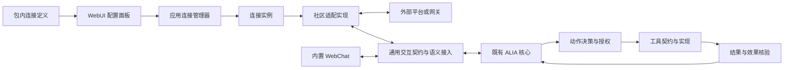
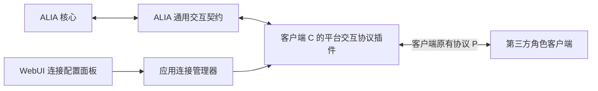
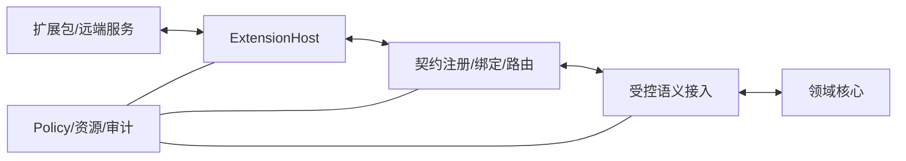

# 专题附录 — 通用扩展平台与开放契约

本规范不依赖预先列举的媒介或工具。契约的可校验形式见 [Schema 目录说明](../../schemas/README.md)。

## 0. 扩展、交互与配置的统一定义

独立外部应用的公开接入规范见 [AEIP](12-EXTERNAL-INTERACTION-PROTOCOL.md)。本章的包安装、ExtensionSession 与 HostControl 不作为所有第三方客户端的前置条件：原生应用直接实现 AEIP；第三方原生协议可由宿主内可注册适配器、客户端插件或独立桥接转换。统一业务语义、传输绑定和适配器注册是分别维护的责任。

原生接入在内部由官方通用 AEIP 网关贡献承载，ConnectorDefinition/ConnectorInstance 的提供者是内置网关，不是一个虚构的第三方包。网关拥有真实宿主会话，peer 的公开协议会话和稳定资源分别关联；不为每个 peer 伪造 ExtensionManifest/ExtensionSession。现有连接和绑定规则继续强制执行，公共权限不能扩大内部许可。宿主内适配可直接经受控 SPI 接入应用语义。

扩展包是安装、版本和生命周期单位；适配器是协议转换职责；工具是向核心开放的操作；模态是信息形式。它们不是互斥的插件种类。一个包可以同时贡献平台接入、媒体处理、工具、命令、Skill 和配置界面，全部复用同一宿主、契约注册和权限机制。

**平台交互协议插件**是明确的插件功能分类：它提供某个平台/客户端原有协议与 ALIA 通用交互契约之间的双向适配实现，以及连接配置入口。工具插件是另一功能分类；同一包可同时具有这些分类，不要求分类互斥。“平台”包括聊天服务、可交互角色客户端和本地桌宠，不限定为远程社交平台。实现上以 `alia.contribution.connector` 识别这一贡献，不在核心枚举平台名称。

统一的是插件管理基础，业务协议按职责区分：

| 契约 / 贡献 | 适用范围 | 接入核心的方式 |
|---|---|---|
| 扩展管理 | 所有扩展包 | 安装、依赖、授权、会话、绑定、隔离与清理 |
| 平台交互 | 与用户交流的平台或本地客户端 | 来源输入、会话/参与者关联、输出端点、交付/取消与回执 |
| 工具 | 浏览器、文件、搜索、日历、代码执行等操作 | ServiceContract 的操作经 AgentCapability 投影，走 Action 授权与 Outcome 核验 |
| 模型 / 媒体处理 | 模型调用、识别、合成、角色渲染等 | 各自服务契约及受控语义映射，不强制实现平台会话 |
| 配置界面 | 按贡献需要提供 | 声明生成表单，特殊流程用隔离面板；配置界面不执行平台连接 |

ConnectorDefinition、ConnectorInstance、SetupSession 与 `alia.connector.management/setup`、`alia.interaction` 专用于平台交互接入，不是所有扩展的必选接口。工具可复用表单、凭据与诊断基础设施，不因此创建聊天连接。桌宠可组合交互、渲染和桌面工具贡献，分别使用对应契约。这里的连接是逻辑接入，可由网络、本地 IPC 或宿主内调用实现。

| 对象 | 责任 / 维护者 | 不等于 |
|---|---|---|
| ALIA 通用交互契约 | 官方定义输入、端点、交付与回执语义 | QQ、Telegram 等外部协议或仅一个传输封套 |
| 外部平台协议 | 外部平台/网关规定认证及通信方式 | ALIA 核心接口 |
| 平台适配实现 | 社区或官方实现连接、收发、格式转换及诊断 | 协议文档、人格或对话决策器 |
| ConnectorDefinition | 包内版本化连接定义，引用配置 Schema、服务契约、凭据槽及可选面板 | 已连接账号或运行状态 |
| ConnectorInstance | 用户创建的实际连接配置与运行投影；由应用连接管理器维护 | ExtensionSession、HostControl.connection_id、Conversation 或 Identity |
| SetupSession | 一次有期限、多步骤的认证/配对流程；应用管理有效状态 | 永久连接、插件会话或新的授权来源 |
| 配置面板 | 宿主按声明生成，特殊交互可由包提供隔离面板 | 平台连接执行器或必装的第二个客户端插件 |
| WebChat | 官方随产品交付的交互实现，提供正式 `/chat` | 测试沙盒、运维权限或独立 ALIA |

具体平台名称只用于包元数据和示例，核心与 WebUI 不维护平台枚举。管理契约处理安装、配置、生命周期和绑定；交互业务契约处理输入/输出。满足既有交互语义的新接入无需修改核心；新语义仍需明确契约、映射和验证，任意 JSON 注册不意味着核心已经理解。

默认一个包同时交付后端适配实现和 WebUI 配置贡献：前者负责协议转换、连接、认证及收发，后者负责用户配置入口。普通字段由声明生成，不要求单独安装前端插件；特殊面板可随包分发。协议说明、安装、配置有效、连接成功和实际交付是不同事实。

### 0.1 接入设计时尚不存在的客户端

假设第三方开源角色客户端 C 使用 Live2D，能接收消息、播放动作和上报点击，并已有自己的协议 P。开发者实现平台交互协议插件 B：外侧按 P 认证和通信，内侧按 ALIA 交互契约接收/发送。ALIA 不需要提前认识 P，客户端 C 也不必修改 P；B 是两端协议的桥接实现，而不是再要求双方改用第三套语言。

协议转换还包括语义：谁发送、回复哪一轮、播放是否完成、取消影响哪些内容、外部标识属于哪个连接。不是只把 JSON 字段改名。安装包声明内侧契约；外侧协议版本、消息映射及客户端兼容范围由适配实现维护，并在连接诊断中报告实际核验结果。宿主协议、业务契约、外部协议及客户端版本分别协商，外部版本不强行按 SemVer 解释。

| 客户端提供的功能 | 接入责任 | 核心边界 |
|---|---|---|
| 用户文本、语音、点击 | 交互适配；媒体解码/识别按需要组合 | 有来源的输入，不把点击直接解释成亲密、同意或真实感受 |
| 字幕、声音、角色表情/动作 | 合法表达投影与交付 | 动作资源 ID、参数、动画混合留在适配/渲染侧；未映射的动作如实不可用 |
| 截屏、文件操作、系统点击 | 工具贡献 | 独立能力、动作授权与效果核验；不能藏在“播放表情”中执行 |
| 地址、配对、模型/输出目标选择 | WebUI 配置贡献 → ConnectorManager | 管理连接及路由配置，不生成对话或提交人格/记忆 |
| 自动眨眼、呼吸、插值 | 客户端局部呈现 | 不形成新的认知决定或亲历事件，不取得额外文件/网络权限 |

同样的桥接方式适用于 QQ、Telegram 和未来平台，前提是存在可使用的外部 API、SDK、插件接口或可实现的协议。只有开源源码但没有接入接口时，需要开发外侧接口/客户端扩展；配置面板不能补出不存在的通信能力。只有模型调用接口的“AI 客户端”可先接有限文本路径，但不因此获得动作、取消、播放或真实交互回执。只有渲染 API 的软件可以作为渲染服务接入，不伪造用户输入或聊天会话。

外侧协议可由适配器主动连接，也可由客户端反向连接、Webhook、轮询或请求/响应驱动。connect/disconnect 表达启用/停用这条逻辑接入，可对应建立 Socket、启动受限监听或注册回调，不强迫每个平台维持长连接。监听可用不证明客户端在场；每个请求仍需认证、路由及端点有效性核验。若客户端只允许配置某种模型接口地址，可在边界实现该接口的兼容入口，再映射到 ALIA 交互流程；兼容外壳不把 ALIA 降为无状态模型调用，也不把客户端历史重放为新经历。

参考设计数据见 [匿名角色客户端桥接样例](../../config/connectors/anonymous-avatar/README.md)。该样例外部协议是假设的，不代表 Live2D 或任何真实客户端的统一协议。

## 1. 稳定内核与开放业务

扩展平台让未来能力自行携带描述、契约与实现；宿主负责验证、运行及治理。生命周期、来源、权限、资源和提交规则由内核治理，业务类型不由模态枚举决定。

Host 和 Router 属于 application/infrastructure；契约值对象可被 domain 引用。适配器、Schema 实现库、OS 驱动不能反向成为领域依赖。

## 2. 对象与身份

| 对象 | 职责和主键 |
|---|---|
| ExtensionManifest | 包的静态自描述：extension_id、package_version、兼容范围、入口摘要、请求权限、提供/依赖契约 |
| ServiceContract | contract_id + version + schema_digest；定义方法、事件、流及各自数据结构，不含执行权限 |
| Provider | 某个会话提供契约的实例；session_id + generation + contract ref |
| Consumer | 请求使用契约的核心服务或扩展；宿主认证身份，不能信任消息内自报身份 |
| ExtensionSession | 包在 host/runtime 上的一次激活，携带有效权限与实际隔离证明 |
| Binding | 一次显式消费者→提供者绑定，固定作用域、代次、契约、授权引用、有效期及撤销版本 |
| AgentCapability | 可供核心系统考虑的语义能力描述；从服务契约受控投影，不等于全部插件 API |
| Contribution | 扩展提供的语义映射、上下文来源或其他扩展贡献；以开放 type_id 标识，不自动取得执行权 |

manifest_version、package_version、host_protocol_range、contract version 与 core schema_version 各自独立。提供者声明精确 SemVer；消费者声明范围，宿主使用标准 SemVer 解析器匹配。正则只做词法校验。内容摘要相同才可复用同一契约版本；同 ID/版本不同内容拒绝。

技术权限和数据作用域均绑定 tenant；身份作用域操作另外绑定 identity/branch/access_scope。宿主自己的扩展会话 ID 与 ALIA 身份、任务和对话 ID 不得混用。

## 3. 安装、激活和退出

包状态：discovered → installed_disabled → enabled；可回到 disabled，最终 removed。installed/enabled 不代表会话 ready。

会话转换：

| 状态 | 合法转换与条件 |
|---|---|
| validated | waiting_dependencies / starting / stopped / failed；包身份、摘要、运行兼容、权限和隔离检查已通过 |
| waiting_dependencies | starting / stopped / failed；必须基于注册表快照检查，订阅变更后再次检查以消除丢信号竞争 |
| starting | ready / stopping / failed；预留声明槽，运行初始化，全部声明就绪后一次发布 |
| ready | degraded / stopping；依赖、授权、隔离、健康状态失效触发降级或立即撤销 |
| degraded | ready / stopping / failed；只在重新检查全部条件后恢复，新调用受限 |
| stopping | stopped / failed；先撤销绑定与发布，再取消工作、释放资源和完成清理 |
| stopped / failed | 终态；重启创建新 session 和递增 generation，不复活旧会话 |

兼容失败、授权不足或隔离不可用时，包保持 disabled/blocked 诊断，不创建可执行会话。等待超时失败。所需依赖图成环时拒绝本次激活并报告环；可选依赖不阻塞，但不能在调用中假装存在。

**事务注册**：验证全部声明→原子预留 ID/版本/作用域槽→初始化→检查会话仍有效→一次发布。重复或冲突注册整体失败；初始化遗漏声明也整体回滚。停止初始化中的会话立即释放预留；其代码以后返回也不能再发布。

**替换与清理**：拒绝同一提供者槽的重复注册；不同安装/会话可以提供同一契约，不能以 contract_id 全局唯一阻止多个平台并存。显式替换同一槽时先禁止旧绑定新调用，再发布新代次。旧调用按效果类别取消或进入核验；不迁移在途调用。清理按资源登记逆序执行，单项失败不跳过其他资源；聚合诊断，超时后隔离/终止执行实例。幂等清理句柄只能影响自己的 session/generation。

## 4. 通信、控制面和数据面

已绑定业务消息只规定 request/response/event/stream_open/stream_chunk/stream_close/cancel/error；业务 member_id、type_id 由注册契约提供。消息必须关联绑定和提供者代次。认证通道派生 caller/scope；消息字段必须与通道身份一致，不能凭 payload 指定其他用户。

- 控制面承载权限、生命周期、绑定、调用结果与流控制；数据面承载 chunk。优先处理停止、撤权和核验。控制面容量独立预留，饱和时拒绝新调用，不静默丢弃已承诺控制工作。
- 同一绑定内控制序列递增，inbox 去重；stream 按各自 sequence 排序。不同流之间不承诺全局时钟顺序。跨源同步必须携带采集时钟 ID、时间范围和已知偏差，未知偏差显式标记。
- 声明 max_chunk_bytes、带宽、并发、缓冲和截止时间；宿主取申请值与实际配额的较小值。消费者用 credit/window 控制发送；可靠流满时阻塞到截止期限后失败，声明可丢弃的观测流可合并/丢旧并报告 gap。权限和结果不得套用丢帧策略。
- request 使用 request ID + action idempotency key（有副作用时）；response 区分 accepted/completed/failed/uncertain。网络 ACK 只表示运输状态。
- cancel 关联目标调用或流。取消生成/播放不等于外部副作用撤销；不可撤销动作转 needs_reconciliation，核验实际效果。
- 断线撤销临时绑定；未确定的写入进入核验。重连须重新认证、协商、读快照和取得新绑定。只有契约声明支持恢复且授权仍有效时，才能按 cursor 恢复流；迟到的旧消息不能跨代次恢复执行。
- 统一错误：incompatible_version、dependency_cycle、provider_conflict、not_ready、permission_denied、stale_binding、stale_read、deadline_exceeded、resource_exhausted、schema_invalid、needs_reconciliation。错误内容同样按数据权限脱敏。

传输位于 adapters，宿主决定本地/远端的执行位置。运行时实现必须采用有界队列和独立控制调度；本规范不要求拆成多个微服务。

## 5. 三层授权与隔离

有效权限 = 包申请 ∩ 管理者授予 ∩ 消费者授权 ∩ 数据同意 ∩ 本次策略决定。缺任一必要依据即拒绝。首次安装保持 disabled，申请更新不能自动扩大旧授权。

包权限不等于用户同意；绑定不等于行动批准；JSON 通过不等于凭证真实。授权记录由可信 Policy 写入，执行器从可信存储解析引用，核对参数摘要、受众、版本、有效期、撤销版本和当前绑定。

不可信扩展必须在进程外且实际强制文件、网络、凭据、CPU、内存和运行期限边界。隔离后端须提交与本次实例关联的可验证配置/探测证据；不得仅接受扩展自报 isolation=true。缺后端时拒绝启动。受信任进程内扩展须明确列入管理者允许名单；其信任不覆盖数据 ACL 和动作策略。

转换器、渲染器、模型适配器、提供商托管工具都在相同权限图内。宿主不得给扩展直接数据库连接、内核 reducer 指针或跨租户通用凭据。

## 6. 开放数据与语义接入

入站路径为认证会话 → binding/generation/contract 校验 → 业务 payload 校验 → 来源/ACL/时间有效性 → 语义候选 → 领域验证。出站路径为候选 → 当前授权及 read_set → 数据流出检查 → 绑定调用 → accepted → 实际效果核验。

核心 1.0 ContentPart 支持 text、reference 和 typed；reference/typed 使用开放 type_id、契约引用及摘要，不要求增加媒体枚举。大型或敏感内容用受控引用；未知 type_id 可保存为不可解释的证据引用，但不得进入主动决策或动作，待解析器具备且授权有效后重新编译。

注册结构只证明可解析。语义转换须声明 consumes/provides 契约和贡献类型；实际结果仍是 DATA，不能变为更高权威指令。有效贡献映射到 Observation、能力候选、表达投影、Outcome；领域状态转换必须符合明确的领域规则并通过受信任验证器。

扩展间服务可以由其他扩展消费，只有经过 policy/语义投影的子集进入模型候选能力。能力说明带用途、参数、限制、效果与来源，按任务相关度和 token 预算筛选，正文说明不获得系统指令权限。

## 7. Port 与状态存储责任

以下为语言无关接口语义，后续 Rust 类型必须从版本化契约统一定义/映射：

| Port | 输入 → 输出 | 强制责任 |
|---|---|---|
| ContractRegistry.Register/Resolve | 契约/精确引用 → 验证结果/不可变契约 | 内容摘要、运行时 Schema、版本冲突 |
| ExtensionHost.Install/Activate/Stop | 包/激活请求 → 安装计划/会话/退出结果 | 来源、授权、隔离、依赖、事务与清理 |
| BindingRouter.Bind/Dispatch/Cancel | 消费请求/授权引用 → 绑定/协议消息/取消结果 | 认证身份、代次、配额、期限和取消 |
| SemanticGateway.Ingest/Project | 来源消息/贡献 → 领域候选/表达投影 | ACL、可信等级、read_set、来源链 |
| ContextSourceStore.Replace/Append/Revoke | source key + revision → 当前快照 | 来源只能修改自己的桶；TTL、撤销和删除屏障 |
| ConnectorManager | 定义/配置/认证管理命令 → 实例修订、操作关联及脱敏状态 | 服务端配置验证、凭据归属、应用/连接代次、启停与恢复；应用职责，不新增人格模块 |

具体存储、索引、约束及初始化见 [数据设计](13-DATA-STORAGE.md)。审计记录 extension/session/generation/binding/contract/request/trace IDs，默认不复制私密 payload。

## 8. 未知扩展验收

内核冻结后，测试作者再提供匿名 X/Y 的契约与实现；X 发布新业务类型，Y 依赖它并提供新贡献。测试不得在内核加入 X/Y 的名称、媒介或业务分支。

必须覆盖依赖晚到、循环、重复注册、初始化部分失败、停止后返回、升级旧代次、授权撤回、数据面拥塞、断线核验及卸载后历史可读。匿名夹具定义协议与预期行为，宿主运行验收归属 E/F。

## 9. 绑定前控制协议与流量控制

HostControl 独立于已绑定业务消息，不要求 binding_id。hello/authenticate 在有界且限速的连接上进行版本与身份检查；未认证连接只允许这两类请求，不能读取领域数据、注册提供者或取得授权。认证凭据通过受保护通道交换，日志仅留 credential_ref，引用本身不证明认证。

宿主认证后才发出 session_opened。binding_request 经验证生成 Binding，binding_result 返回引用；grant/revoke/status/stop/stream_credit/ack 均由宿主按认证身份、归属和消息方向检查。只有可信 policy/管理控制器可以产生 grant/revoke，扩展自发同形消息必须拒绝。stream_credit 控制数据流窗口，不改变契约或权限。ack.recorded 仅表示控制消息已记录。

这样，连接和会话管理不依赖尚未建立的业务绑定，也不强迫高频数据携带安装控制行为。HostControl 的 JSON 校验不替代传输认证与方向检查。

## 10. 授权摘要与协议持久性

ActionDigest 定义为 SHA-256(RFC 8785 JCS(完整 ActionProposal 1.0))，包括 scope、数据用途、参数、受众、读集、绑定、期限及全部候选字段。禁止使用无序 map 的普通 JSON 序列化或只对 input 摘要；修改任一受保护字段必须形成新候选并重新授权。授权记录从不参与自身摘要。示例夹具只验证固定示例的摘要，不代表已实现通用 JCS 或授权服务。

ContractRegistry 的 schema_digest 对发布文件原始字节计算，不能与 ActionDigest 的 JCS 算法混用。业务契约允许采用本地已注册的受限引用；拒绝任意网络取回 $ref，限制递归深度、大小和验证耗时。事件、方法、流的 payload 逐次按准确引用校验。重复 member 名称、悬空引用及同版本不同摘要拒绝注册。

## 11. 依赖解析与时间基准

消费者范围匹配基于同一注册表快照：优先选择满足范围的最高稳定 SemVer，预发布版本仅在范围明确允许时参与。相同优先级的不同构建/摘要不得任意选择，返回歧义诊断，要求显式版本/摘要绑定。解析结果写入 binding，后续新版本出现不改变已有绑定。选择后的必需依赖图检查循环，缺失时等待，错误版本保留诊断。

版本选择不等于提供者选择。同一契约多个实现并存时，按管理者所选安装/贡献定位准确 provider_session/generation；没有明确选择就报告歧义，不能随机选、按加载顺序选或把新平台视为旧平台升级。连接业务的 binding_request 和 BindingGrant 必须含 provider_ref 与 resource_ref；Binding 固定 provider_session_id/provider_generation 与相同 resource_ref。resource_ref 的 type_id 为 connector.instance，resource_id 为 connector_id；宿主验证三者一致且调用中的 connector_id 相符。一次绑定只服务一个实例；配置/连接代次另由 ConnectorManager 复验。实例是 tenant 级配置，每个管理/交互绑定仍使用已有认证 scope，不因创建账号而创建新 Identity。

资源约束不只适用于三个标准服务 ID。定义的 connection_dependents 指明同一安装内哪些贡献依赖此连接及各自所需 features；其服务绑定也必须含相同 connector.instance、准确提供者及当前连接条件。宿主从已验证定义推导这一要求，不能由调用者省略 resource_ref 降级成无实例调用。一个服务同时服务多个贡献时按声明合并依赖检查，不靠任意贡献别名逃逸；跨安装复用必须显式绑定所有者提供的受限服务，不能共享原始凭据/Socket。工具没有声明此依赖时仍可独立运行，不要求每个工具创建连接。

合并的是资源归属检查，不是要求同一服务的所有可选功能同时可用。具体调用按实际贡献/成员及端点核验所需能力；文字交付不因可选动作缺失被全局阻塞。依赖信息只限制可用性，不能直接使表达或工具动作获得授权。

同一服务实现可被多个定义复用，绑定时按实际实例的定义选择关联贡献；需要不同连接所有者时声明不同贡献 ID，不要求复制实现代码或核心。不能仅按 contract_id 把另一实例的依赖或能力状态混入当前调用。

deadline 的执行以宿主认证接收时的可信时钟换算为单调计时，不能信任扩展自报 occurred_at 延长授权或期限。采集时钟与控制截止时钟分开；无法确认跨源偏差时不假定已精确同步。已结束/撤销的消息不能通过重发较新时间恢复。

BindingGrant 是技术绑定授权的独立版本化记录，限制 consumer/session、契约、成员、调用/订阅/流操作、用途、受众和期限；不带全局通配权限。Binding.authorization_ref 解析此记录。ActionProposal 的一次行动另外解析 core AuthorizationRecord；两种凭证均由可信 Policy 保存并核验当前撤销版本，不因 JSON 合法自动可信。

## 12. 执行边界

ExtensionHost 采用 Rust 应用/适配实现，协议仍是开放、语言无关的版本化值。Wasmtime/WASI 后端与原生进程外后端都须满足同一授权、隔离和代次规则，不能用 Rust 内部 ABI 做稳定插件边界。React/Tauri 仅消费受控投影；技术详细边界见 [技术选型](14-TECHNOLOGY-STACK.md)。

## 13. 增量媒体与技能控制的开放边界

扩展可提供增量观察、输出播放位置、路径变化、受限技能及效果核验，但它们都是有来源的数据/能力，不直接提交 Persona、CommonGround 或关系边界。核心掌握解释、候选与提交；插件的“看起来用户生气了”不是关系事实或同意。

未来 ExpressionPlan 使用 typed 负载时，必须完成契约注册和版本/摘要验证，不能借开放 payload 绕过语义校验。媒体能力协商除模态还须覆盖输入修订、取消/门控、端点本地暂停和位置单位；游戏控制器还须支持用户抢占、租约代次和前置条件核验。缺少能力时如实降级，不用 fake 回执掩盖。

拒绝可选权限只允许保留不依赖它的能力；拒绝必需权限则相关能力不可用。安装成功/绑定就绪不等于完成真实业务。详细状态与时序见 [情境行为](15-SITUATED-BEHAVIOR.md)、[时序推演](18-BEHAVIOR-VALIDATION.md)。

## 14. 自描述接入包与配置

可注册协议适配器使用开放贡献 alia.contribution.protocol-adapter，descriptor_ref 引用 schemas/aeip/adapter.schema.json 所定义的声明，携带外侧协议、版本范围、双向映射和生命周期责任；其 contract_ref 为主业务契约，其他映射契约仍须准确声明提供/使用关系。注册不执行翻译或授予权限，ConnectorDefinition 继续负责需要的连接配置。未知平台按声明注册，不新增核心或通用 WebUI 平台名称分支。独立 AEIP 客户端不需要这个宿主贡献。

首版结构见 `schemas/extension/connector-definition.schema.json`、`connector-instance.schema.json`、`setup-session.schema.json`；标准业务服务见 `schemas/services/`。它们都是 draft，不代表适配器已经实现。完整示例见 [接入样例](../../config/connectors/README.md)。

manifest 的 `alia.contribution.connector` 贡献通过 `descriptor_ref` 引用包内连接定义原始字节的 SHA-256；该贡献的 contract_ref 指向管理服务。资源路径只允许包内规范相对路径，拒绝路径穿越、绝对路径、符号链接逃逸及网络取回。连接定义的服务引用必须匹配包声明和已注册契约，定义 ID/版本内容不可变。静态定义可以在包尚未运行时验证和展示；它不激活插件、不执行配置代码、不建立连接。

连接定义保存普通配置 Schema、配置版本、字段提示、命名凭据槽、执行位置和所提供服务。Schema 必须通过受限 2020-12 元验证及资源限制；显示提示不能改变服务端验证语义。标准表单支持对象、数组、文本、数值、布尔、枚举和嵌套结构；复杂组合不静默丢字段，使用受验证的结构化编辑或明确要求面板支持。显示文案按数据转义，不运行表达式或任意 JavaScript。声明的初始配置不是用户已同意启用的状态。

features 是适配实现可支持的上限，required_features 指定该交互实例的最低可用组合，省略时取全部已声明 features。实时可用能力来自获准探测与端点协商，不从包描述推定。缺少必需能力为 unavailable；必需能力齐全但可选能力缺失为 degraded，合法可用路径仍可执行；全部声明能力可用时才为 ready。每项调用检查自己需要的能力，不把总状态当执行许可。

connection_dependents 仅声明连接依赖，不签发权限或复制贡献。列表中的 contribution_id 必须在本包清单存在、不能指向连接贡献自身，required_features 非空且属于该定义 features；同一安装的一个贡献只能有一个连接定义所有者。宿主在调用前验证服务、贡献与资源关联，管理服务初始化不能反向等待业务贡献 ready。

凭据槽与普通配置分开。管理者经认证写入 CredentialStore，实例只保存 credential_ref；对 UI 返回是否已设置及必要脱敏元信息，不回显已有密钥。插件只能通过获准的实例/槽访问凭据，不能借自报引用读取其他实例材料。普通配置不得携带凭据明文；迁移和诊断同样遵守这一边界。

一个安装包可以提供多个连接定义，一个定义可创建多个实例。包级配置归安装；账号/地址归实例；认证挑战归 SetupSession。实例 ID 在 tenant 内唯一；外部账号、消息/线程和参与者 ID 在连接来源命名空间内解释，昵称不作为认证。账号绑定改变必须重新建立路由关联，不复用旧授权、对话和端点。多个实例确属同一外部来源时，关联与去重须经显式来源核验，不能凭字符串合并。

配置保存以 expected_revision 和幂等键提交，返回新的 configuration_revision；不自动连接。test 只执行声明的有界连接探测，不发聊天消息或启用业务；须有独立管理授权。启动时记录 applied_configuration_revision 和单调 connection_generation；同代次不热换账号/凭据。影响当前连接的保存先使其停止承接新业务，再受控断开/核验并以新代次连接。无关展示字段可重绘，不能假装旧连接已经应用新配置。

安装版本、实例配置版本和正在应用的版本分别保存。升级在停用旧提供者后重新验证：不兼容标 needs_revision，要求显式修订；首版不运行任意迁移脚本、不静默删除字段或继承新增权限。卸载撤销定义可用性、绑定、认证流程和端点；合法历史按数据政策保留，删除配置/凭据/历史是独立的有范围操作。

## 15. 就绪状态与多阶段认证

连接管理器维护 configuration_status、authentication_status、connection_status、availability，包 installed/enabled 和 ExtensionSession.ready 仍由宿主维护。`ready` 仅在配置已应用、认证仍有效、连接和所需能力可用、授权/绑定有效时成立；JSON 形状不能证明这些条件。connected 也可能因撤权处于 unavailable，立即禁止业务，断开清理可以随后完成。

管理服务在账号未连接时即可 ready；先授予配置/认证操作所需的管理绑定，交互绑定和端点须等实际连接条件通过核验。这避免“必须连接才能打开登录面板”。配置表单静态读取不依赖后台进程启动，远程探测/认证则必须有有效管理绑定。`HostControl.connection_id` 是扩展通信连接；`connector_id` 是平台配置实例，二者不可互换。

就绪顺序为：管理绑定可用 → 校验配置/凭据 → 分配并持久化新的 connection_generation → 调用 connect → 核验连接及所需能力 → 建立该实例的交互绑定/端点 → 发布 availability。建立交互绑定检查的是前面的连接条件，不以前一版本 availability=ready 为前提；不得形成“ready 等绑定、绑定等 ready”的循环。connected 尚无有效交互绑定时仍 unavailable；断开或撤权立即关闭业务准入，再清理资源。

宿主事务发布的“服务就绪”表示声明的处理接口已经初始化，不要求全部账号在线。管理与交互服务可随同一会话注册，但交互业务还受实例准入条件约束；未连接实例不能取得可用交互路径。一个账号失败只降级相关资源，除非包进程或声明的必需依赖整体失败，不将其他实例或独立工具全部停用。

SetupSession 固定 tenant、connector_id、连接定义、configuration_revision、extension_session_id/generation、操作者和有效期；每个步骤带 step_id/revision。begin/submit/cancel/poll 通过宿主代理管理服务。表单、受控二维码引用、HTTPS 跳转和提示是通用步骤，不以平台名分支。submit 核对 expected_revision 与当前步骤的 input_schema；挑战与暂存值有 TTL，超时/取消/配置变化/停用使后续回调失效。成功必须由宿主核验服务结果并将获准凭据提交 CredentialStore，插件自报 succeeded 不直接授予账号权限。

恢复不重放已提交认证步骤；无法核验的流程终止并重新开始。关闭页面不取消服务端连接；显式取消、期限或政策才终止认证流程。声明 execution_location=client 的客户端离线时，仅相关输入/输出路径不可用，不伪造持续在线。

自定义配置面板默认可选并随同一包分发，引用带摘要的包内资源及 allowed_operations 应用管理操作白名单。桥的目标是 ConnectorManager 应用命令，不能直接绑定适配器的 validate/connect/disconnect 等 provider 方法；应用先检查归属、修订、幂等、凭据和状态转换，再调用适配器。这防止面板跳过配置提交或代次分配。

宿主以隔离源/沙箱、受限消息桥和浏览器内容策略约束面板；主窗口凭据、存储、原生桥及任意网络访问不向其开放。每次桥调用验证操作者、实例、操作、版本、输入和管理授权。允许操作列表只是上限，不代替用户权限；面板不能提交连接已成功或业务已送达。面板崩溃不关闭独立实例，基本状态/断开入口仍由宿主提供。第三方角色客户端是运行中的交互端，WebUI 配置面板是管理端，两者不是同一个“客户端插件”。

## 16. 通用交互与受控命令

标准 `alia.connector.management` 承担 validate/test/connect/disconnect/status；`alia.connector.setup` 承担 begin/submit/cancel/poll；`alia.interaction` 承担 input、endpoint、deliver/cancel、receipt。全部是业务契约，版本与 extension 1.0 独立；接收、交付、控制和可选流能力按服务成员与 feature 声明组合。没有 cancel/播放证据能力时不宣称已停止/已播放；额外实时流以独立的已注册业务契约声明，不将所有 chunk 永久记作事件。

入站 input 保留外部事件 ID/修订、会话/线程/回复关联、参与者引用、时间与 ContentPart。插件不指定可信 actor、identity、sequence 或 policy；SemanticGateway 从绑定、实例及合法映射派生作用域，perception 标准化为 Observation，runtime 做 inbox 去重、编辑/撤回失效与 Turn 关联。来源修订传播到依赖的认知/需要/记忆候选。source_session_id 是宿主分配的来源会话，不等于外部会话 ID。

出站必须来自合法 ExpressionPlan/Action 与 outbox，固定实例/连接代次、端点及受众修订、过期和取消代次；适配器只执行投影与报告事实。端点本地引用在绑定内解释，不允许调用者用任意地址替换受众。BindingRouter 复验宿主代次，ConnectorManager 另验连接代次和已应用配置；网络 SDK 对象不进入核心。普通回复与主动发送工具复用受控交付/幂等记录，不发两次；主动发送仍需对应动作授权。

deliver 的 accepted 是接单，receipt 才回报可证明的交付事实，复用 core DeliveryReceipt；平台只报告发送受理时，不补造 displayed/played 或 completed。端点、受众、内容与真实范围由 runtime 校验，迟到结果用于核验但不复活旧许可。WebChat 是同契约的官方实现，浏览器传输仍用既有 HTTP/SSE，不强制把前端启动为插件进程；刷新按授权快照与 cursor 恢复，关闭窗口不重置身份。

浏览器工具等单纯工具只需自己的 ServiceContract 和 AgentCapability；宿主完成相同的安装/绑定检查，核心按操作参数、效果类别、取消能力与权限选择调用，返回值仍是有来源的 DATA。工具可执行不依赖任何 ConnectorInstance 或 `alia.interaction` 提供者。若同一包还提供交互贡献，仅该贡献承担连接契约；其停用是否影响工具由明确依赖决定，不做全局联动。示例见 [浏览器读取工具](../../config/tools/browser-read/README.md)。

命令贡献声明命名空间、参数 Schema、作用域、目标服务成员及受限能力引用。认证后的明确命令可走既有 fast 路径，生成确定性 Decision/Action 候选而不必调用模型。授权后才执行处理器，结果经既有 Expression/Delivery 交付；长工作交 agency Task。命令可调用与模型可见分别配置，冲突要求显式别名，不按加载顺序抢占。停止/撤权优先于插件分发。事件规则仅订阅获准输入并提出候选，Skill 仅提供有来源的方法资料；它们不改系统提示权威、领域 reducer、人格、记忆或需要，也不新增调度/权限系统。

## 17. 组合客户端的唯一责任与反馈闭环

| 对象 | 唯一责任 | 其他参与者的边界 |
|---|---|---|
| 包/进程 | ExtensionHost 管理安装、隔离及会话代次 | 管理界面只提交命令，连接管理器不另启一套宿主 |
| 逻辑连接 | ConnectorManager 提交配置、目标状态、代次及核验后的运行投影；适配实现维护实际传输 | 渲染/工具复用连接所有者提供的受限入口，不各自重连、改凭据或关闭共享通道 |
| 贡献可用性 | 宿主结合连接、依赖、授权和实时能力派生 | connection_dependents 不是另一份 Provider 或状态机，发现不等于可执行 |
| 身份与路由 | 应用按授权把实例来源/参与者/会话关联到既有身份分支 | 配置一个客户端不创建新人格，外部账号/模型文件不指定 ALIA 身份；不明确就拒绝路由或要求配置 |
| 表达与交付 | expression/runtime 拥有合法计划、输出关联和核验回执 | 外部客户端负责呈现；配置面板、渲染器与工具不各自生成对同一输入的另一份回复 |

一个逻辑连接可包含多个 Socket、音频流或本地 IPC；它们共享实例归属和失效屏障，不等于必须复用一个物理通道。execution_location 表示适配代码位置，不是对外部客户端在线的保证；服务端适配器所连的桌面客户端退出，同样使相关能力失效。可选渲染服务失败仅关闭依赖它的路径，底层连接失败则影响所有 connection_dependents；独立工具仍按自身依赖运行。

每条表达片段只有一个执行归属：可以由交互适配器内部调用客户端渲染，也可由明确选定的渲染服务承担，不能同时经 deliver 和工具调用重复播放。沿用 output_delivery_id/segment_id/幂等关联。客户端回显自己的台词、播放通知和动作完成只进入对应回执/Outcome，不重新当用户输入触发无限回复；按可靠来源与操作关联识别回显，不用文本相同就吞掉真实用户引用。

外部客户端已有 AI、聊天历史或自动工具系统时，ALIA 接管的交互必须明确选定对话决策责任。客户端不得同时把同一输入交给自己的 AI 再冒充 ALIA 回复；无法关闭或区分时只能标注为受限集成。外部 system/assistant/tool 字段、历史与配置提示仍为来源数据，不能覆盖 ALIA 的 Prompt 权威、人格、记忆或授权；需要导入历史时走独立受控导入，不把整份历史每次重放为新事件。

新平台接入分三种情况：①现有语义、不同外部协议，仅补适配实现；②现有语义、新编码/模态表示，补注册的类型、解码/表达映射和验证；③新的认知或动作语义，补明确消费者、权限/效果规则和验收后才开放。不能承诺任意未来语义都无需改变任何实现，也不能因新增平台名称就复制核心。兼容性检查覆盖双向映射、支持版本、遗漏/降级、受众、单位、取消和回执含义。

客户端协议升级、模型切换或动作映射变化时，先使受影响能力/端点修订失效，再核验协议和资源表；不能用同名动作 ID 静默执行旧候选。映射版本/模型资源修订纳入相关 read_set，连接重建同时变更 connection_generation。不支持的语义保持不透明或明确拒绝，允许有依据的文本降级；不得生成假的动作完成回执。
