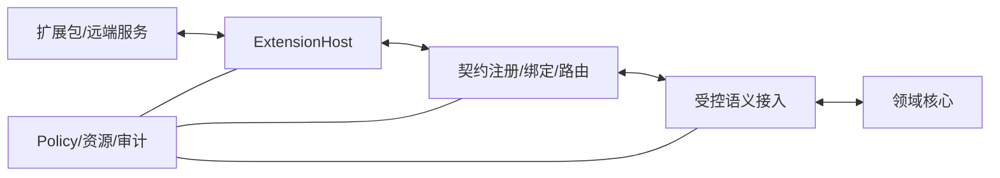

# 专题附录 — 通用扩展平台与开放契约

本规范不依赖预先列举的媒介或工具。契约的可校验形式见 [Schema 目录说明](../../schemas/README.md)。

## 1. 稳定内核与开放业务

扩展平台让未来能力自行携带描述、契约与实现；宿主负责验证、运行及治理。生命周期、来源、权限、资源和提交规则由内核治理，业务类型不由模态枚举决定。

Host 和 Router 属于 application/infrastructure；契约值对象可被 domain 引用。适配器、Schema 实现库、OS 驱动不能反向成为领域依赖。

## 2. 对象与身份

| 对象 | 职责和主键 |
|---|---|
| ExtensionManifest | 包的静态自描述：extension_id、package_version、兼容范围、入口摘要、请求权限、提供/依赖契约 |
| ServiceContract | contract_id + version + schema_digest；定义方法、事件、流及各自数据结构，不含执行权限 |
| Provider | 某个会话提供契约的实例；session_id + generation + contract ref |
| Consumer | 请求使用契约的核心服务或扩展；宿主认证身份，不能信任消息内自报身份 |
| ExtensionSession | 包在 host/runtime 上的一次激活，携带有效权限与实际隔离证明 |
| Binding | 一次显式消费者→提供者绑定，固定作用域、代次、契约、授权引用、有效期及撤销版本 |
| AgentCapability | 可供核心系统考虑的语义能力描述；从服务契约受控投影，不等于全部插件 API |
| Contribution | 扩展提供的语义映射、上下文来源或其他扩展贡献；以开放 type_id 标识，不自动取得执行权 |

manifest_version、package_version、host_protocol_range、contract version 与 core schema_version 各自独立。提供者声明精确 SemVer；消费者声明范围，宿主使用标准 SemVer 解析器匹配。正则只做词法校验。内容摘要相同才可复用同一契约版本；同 ID/版本不同内容拒绝。

技术权限和数据作用域均绑定 tenant；身份作用域操作另外绑定 identity/branch/access_scope。宿主自己的扩展会话 ID 与 ALIA 身份、任务和对话 ID 不得混用。

## 3. 安装、激活和退出

包状态：discovered → installed_disabled → enabled；可回到 disabled，最终 removed。installed/enabled 不代表会话 ready。

会话转换：

| 状态 | 合法转换与条件 |
|---|---|
| validated | waiting_dependencies / starting / stopped / failed；包身份、摘要、运行兼容、权限和隔离检查已通过 |
| waiting_dependencies | starting / stopped / failed；必须基于注册表快照检查，订阅变更后再次检查以消除丢信号竞争 |
| starting | ready / stopping / failed；预留声明槽，运行初始化，全部声明就绪后一次发布 |
| ready | degraded / stopping；依赖、授权、隔离、健康状态失效触发降级或立即撤销 |
| degraded | ready / stopping / failed；只在重新检查全部条件后恢复，新调用受限 |
| stopping | stopped / failed；先撤销绑定与发布，再取消工作、释放资源和完成清理 |
| stopped / failed | 终态；重启创建新 session 和递增 generation，不复活旧会话 |

兼容失败、授权不足或隔离不可用时，包保持 disabled/blocked 诊断，不创建可执行会话。等待超时失败。所需依赖图成环时拒绝本次激活并报告环；可选依赖不阻塞，但不能在调用中假装存在。

**事务注册**：验证全部声明→原子预留 ID/版本/作用域槽→初始化→检查会话仍有效→一次发布。重复或冲突注册整体失败；初始化遗漏声明也整体回滚。停止初始化中的会话立即释放预留；其代码以后返回也不能再发布。

**替换与清理**：默认拒绝重复提供者；显式替换时先禁止旧绑定新调用，再发布新代次。旧调用按效果类别取消或进入核验；不迁移在途调用。清理按资源登记逆序执行，单项失败不跳过其他资源；聚合诊断，超时后隔离/终止执行实例。幂等清理句柄只能影响自己的 session/generation。

## 4. 通信、控制面和数据面

已绑定业务消息只规定 request/response/event/stream_open/stream_chunk/stream_close/cancel/error；业务 member_id、type_id 由注册契约提供。消息必须关联绑定和提供者代次。认证通道派生 caller/scope；消息字段必须与通道身份一致，不能凭 payload 指定其他用户。

- 控制面承载权限、生命周期、绑定、调用结果与流控制；数据面承载 chunk。优先处理停止、撤权和核验。控制面容量独立预留，饱和时拒绝新调用，不静默丢弃已承诺控制工作。
- 同一绑定内控制序列递增，inbox 去重；stream 按各自 sequence 排序。不同流之间不承诺全局时钟顺序。跨源同步必须携带采集时钟 ID、时间范围和已知偏差，未知偏差显式标记。
- 声明 max_chunk_bytes、带宽、并发、缓冲和截止时间；宿主取申请值与实际配额的较小值。消费者用 credit/window 控制发送；可靠流满时阻塞到截止期限后失败，声明可丢弃的观测流可合并/丢旧并报告 gap。权限和结果不得套用丢帧策略。
- request 使用 request ID + action idempotency key（有副作用时）；response 区分 accepted/completed/failed/uncertain。网络 ACK 只表示运输状态。
- cancel 关联目标调用或流。取消生成/播放不等于外部副作用撤销；不可撤销动作转 needs_reconciliation，核验实际效果。
- 断线撤销临时绑定；未确定的写入进入核验。重连须重新认证、协商、读快照和取得新绑定。只有契约声明支持恢复且授权仍有效时，才能按 cursor 恢复流；迟到的旧消息不能跨代次恢复执行。
- 统一错误：incompatible_version、dependency_cycle、provider_conflict、not_ready、permission_denied、stale_binding、stale_read、deadline_exceeded、resource_exhausted、schema_invalid、needs_reconciliation。错误内容同样按数据权限脱敏。

传输位于 adapters，宿主决定本地/远端的执行位置。运行时实现必须采用有界队列和独立控制调度；本规范不要求拆成多个微服务。

## 5. 三层授权与隔离

有效权限 = 包申请 ∩ 管理者授予 ∩ 消费者授权 ∩ 数据同意 ∩ 本次策略决定。缺任一必要依据即拒绝。首次安装保持 disabled，申请更新不能自动扩大旧授权。

包权限不等于用户同意；绑定不等于行动批准；JSON 通过不等于凭证真实。授权记录由可信 Policy 写入，执行器从可信存储解析引用，核对参数摘要、受众、版本、有效期、撤销版本和当前绑定。

不可信扩展必须在进程外且实际强制文件、网络、凭据、CPU、内存和运行期限边界。隔离后端须提交与本次实例关联的可验证配置/探测证据；不得仅接受扩展自报 isolation=true。缺后端时拒绝启动。受信任进程内扩展须明确列入管理者允许名单；其信任不覆盖数据 ACL 和动作策略。

转换器、渲染器、模型适配器、提供商托管工具都在相同权限图内。宿主不得给扩展直接数据库连接、内核 reducer 指针或跨租户通用凭据。

## 6. 开放数据与语义接入

入站路径为认证会话 → binding/generation/contract 校验 → 业务 payload 校验 → 来源/ACL/时间有效性 → 语义候选 → 领域验证。出站路径为候选 → 当前授权及 read_set → 数据流出检查 → 绑定调用 → accepted → 实际效果核验。

核心 1.0 ContentPart 支持 text、reference 和 typed；reference/typed 使用开放 type_id、契约引用及摘要，不要求增加媒体枚举。大型或敏感内容用受控引用；未知 type_id 可保存为不可解释的证据引用，但不得进入主动决策或动作，待解析器具备且授权有效后重新编译。

注册结构只证明可解析。语义转换须声明 consumes/provides 契约和贡献类型；实际结果仍是 DATA，不能变为更高权威指令。有效贡献映射到 Observation、能力候选、表达投影、Outcome；领域状态转换必须符合明确的领域规则并通过受信任验证器。

扩展间服务可以由其他扩展消费，只有经过 policy/语义投影的子集进入模型候选能力。能力说明带用途、参数、限制、效果与来源，按任务相关度和 token 预算筛选，正文说明不获得系统指令权限。

## 7. Port 与状态存储责任

以下为语言无关接口语义，后续 Rust 类型必须从版本化契约统一定义/映射：

| Port | 输入 → 输出 | 强制责任 |
|---|---|---|
| ContractRegistry.Register/Resolve | 契约/精确引用 → 验证结果/不可变契约 | 内容摘要、运行时 Schema、版本冲突 |
| ExtensionHost.Install/Activate/Stop | 包/激活请求 → 安装计划/会话/退出结果 | 来源、授权、隔离、依赖、事务与清理 |
| BindingRouter.Bind/Dispatch/Cancel | 消费请求/授权引用 → 绑定/协议消息/取消结果 | 认证身份、代次、配额、期限和取消 |
| SemanticGateway.Ingest/Project | 来源消息/贡献 → 领域候选/表达投影 | ACL、可信等级、read_set、来源链 |
| ContextSourceStore.Replace/Append/Revoke | source key + revision → 当前快照 | 来源只能修改自己的桶；TTL、撤销和删除屏障 |

具体存储、索引、约束及初始化见 [数据设计](13-DATA-STORAGE.md)。审计记录 extension/session/generation/binding/contract/request/trace IDs，默认不复制私密 payload。

## 8. 未知扩展验收

内核冻结后，测试作者再提供匿名 X/Y 的契约与实现；X 发布新业务类型，Y 依赖它并提供新贡献。测试不得在内核加入 X/Y 的名称、媒介或业务分支。

必须覆盖依赖晚到、循环、重复注册、初始化部分失败、停止后返回、升级旧代次、授权撤回、数据面拥塞、断线核验及卸载后历史可读。匿名夹具定义协议与预期行为，宿主运行验收归属 E/F。

## 9. 绑定前控制协议与流量控制

HostControl 独立于已绑定业务消息，不要求 binding_id。hello/authenticate 在有界且限速的连接上进行版本与身份检查；未认证连接只允许这两类请求，不能读取领域数据、注册提供者或取得授权。认证凭据通过受保护通道交换，日志仅留 credential_ref，引用本身不证明认证。

宿主认证后才发出 session_opened。binding_request 经验证生成 Binding，binding_result 返回引用；grant/revoke/status/stop/stream_credit/ack 均由宿主按认证身份、归属和消息方向检查。只有可信 policy/管理控制器可以产生 grant/revoke，扩展自发同形消息必须拒绝。stream_credit 控制数据流窗口，不改变契约或权限。ack.recorded 仅表示控制消息已记录。

这样，连接和会话管理不依赖尚未建立的业务绑定，也不强迫高频数据携带安装控制行为。HostControl 的 JSON 校验不替代传输认证与方向检查。

## 10. 授权摘要与协议持久性

ActionDigest 定义为 SHA-256(RFC 8785 JCS(完整 ActionProposal 1.0))，包括 scope、数据用途、参数、受众、读集、绑定、期限及全部候选字段。禁止使用无序 map 的普通 JSON 序列化或只对 input 摘要；修改任一受保护字段必须形成新候选并重新授权。授权记录从不参与自身摘要。示例夹具只验证固定示例的摘要，不代表已实现通用 JCS 或授权服务。

ContractRegistry 的 schema_digest 对发布文件原始字节计算，不能与 ActionDigest 的 JCS 算法混用。业务契约允许采用本地已注册的受限引用；拒绝任意网络取回 $ref，限制递归深度、大小和验证耗时。事件、方法、流的 payload 逐次按准确引用校验。重复 member 名称、悬空引用及同版本不同摘要拒绝注册。

## 11. 依赖解析与时间基准

消费者范围匹配基于同一注册表快照：优先选择满足范围的最高稳定 SemVer，预发布版本仅在范围明确允许时参与。相同优先级的不同构建/摘要不得任意选择，返回歧义诊断，要求显式版本/摘要绑定。解析结果写入 binding，后续新版本出现不改变已有绑定。选择后的必需依赖图检查循环，缺失时等待，错误版本保留诊断。

deadline 的执行以宿主认证接收时的可信时钟换算为单调计时，不能信任扩展自报 occurred_at 延长授权或期限。采集时钟与控制截止时钟分开；无法确认跨源偏差时不假定已精确同步。已结束/撤销的消息不能通过重发较新时间恢复。

BindingGrant 是技术绑定授权的独立版本化记录，限制 consumer/session、契约、成员、调用/订阅/流操作、用途、受众和期限；不带全局通配权限。Binding.authorization_ref 解析此记录。ActionProposal 的一次行动另外解析 core AuthorizationRecord；两种凭证均由可信 Policy 保存并核验当前撤销版本，不因 JSON 合法自动可信。

## 12. 执行边界

ExtensionHost 采用 Rust 应用/适配实现，协议仍是开放、语言无关的版本化值。Wasmtime/WASI 后端与原生进程外后端都须满足同一授权、隔离和代次规则，不能用 Rust 内部 ABI 做稳定插件边界。React/Tauri 仅消费受控投影；技术详细边界见 [技术选型](14-TECHNOLOGY-STACK.md)。

## 13. 增量媒体与技能控制的开放边界

扩展可提供增量观察、输出播放位置、路径变化、受限技能及效果核验，但它们都是有来源的数据/能力，不直接提交 Persona、CommonGround 或关系边界。核心掌握解释、候选与提交；插件的“看起来用户生气了”不是关系事实或同意。

未来 ExpressionPlan 使用 typed 负载时，必须完成契约注册和版本/摘要验证，不能借开放 payload 绕过语义校验。媒体能力协商除模态还须覆盖输入修订、取消/门控、端点本地暂停和位置单位；游戏控制器还须支持用户抢占、租约代次和前置条件核验。缺少能力时如实降级，不用 fake 回执掩盖。

拒绝可选权限只允许保留不依赖它的能力；拒绝必需权限则相关能力不可用。安装成功/绑定就绪不等于完成真实业务。详细状态与时序见 [情境行为](15-SITUATED-BEHAVIOR.md)、[时序推演](18-BEHAVIOR-VALIDATION.md)。
