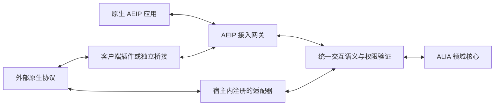

# 专题附录 — ALIA 外部交互协议（AEIP）与适配器接口

状态：AEIP 1.0 草案，未发布、未实现。本文是对外协议的唯一规范入口；JSON 形状见 `schemas/aeip`，业务成员见 Schema catalog 中 `alia.peer.*` 契约。SDK、网关和模拟端均待工程实施，结构检查不是互操作证明。

## 1. 目标、分层与接入路径

协议统一、连接方式解耦、平台能力适配。核心不预知平台名称；符合既有语义的新平台通过外围适配接入。第三方必须具有可用 API、SDK、插件接口或可实现的协议；接口不存在时不承诺自动接入。

| 层 | 责任 | 不承担的责任 |
|---|---|---|
| AEIP | 公开会话、协商、绑定、请求/事件/结果、错误和恢复 | 插件安装、领域状态直接提交 |
| 传输绑定 | JSON 帧、连接发起、认证通道、重连与流量承载 | 身份、人格、平台语义 |
| Adapter SPI / SDK | 注册、配置、生命周期、外部协议与 ALIA 语义双向映射 | 自行授权、另一份认知与记忆 |
| 接入网关与 SemanticGateway | 身份核验、作用域、契约验证、路由、候选接入及受控投影 | 新的人格模块或独立服务要求 |
| 既有领域核心 | Observation、Decision、ExpressionIntent、Action、Outcome 及合法状态转换 | Socket、客户端 SDK、平台名称分支 |

原生应用只实现公开协议及所选业务契约，不安装 ALIA 平台插件，不提交 manifest。宿主内适配器按既有 ExtensionHost/ConnectorManager 管理，可经受控 SPI 直接调用应用服务，不强迫序列化绕行网络。外部客户端插件和独立桥接通过 AEIP；发行位置不改变业务语义。

AEIP 是外部边界，HostControl 是包激活/绑定边界，WebUI 管理 API 是受权管理边界，MCP/A2A 和模型接口各有用途。它们可以共享基础设施，不能凭相似 JSON 或 request 名称互相替代。

## 2. 标识、来源与认证

| 标识 | 含义 / 权威 |
|---|---|
| peer_id | 应用安装/接入端的稳定标识，由管理者注册并与凭据核验；自报不构成认证 |
| session_id / generation | 网关签发的一次协议会话及代次；新连接重新签发，不是 ExtensionSession 或 Conversation |
| resource_ref / target_ref | 网关授权的外部账号/设备资源和 ALIA 目标投影；不允许客户端任意选择 tenant、identity 或 branch |
| binding_id | 网关签发的准确提供者、资源、契约、成员和能力修订绑定 |
| actor_ref / conversation_ref | 来源资源内的外部引用，经应用映射为 Principal/Actor/Conversation；不能作为跨平台全局 ID |
| request_id / idempotency_key | 逻辑操作及副作用重试关联；与一次发送的 message_id 分开 |

认证凭据由受权管理流程预先配置，不在本协议中自动注册可信身份。互联网传输必须使用 TLS 并验证对端；ALIA 主动连接的目标必须来自获准配置，不接受未认证消息指定任意拨号地址。

当 peer 是 WS Server 时，必须先认证主动连接的 ALIA 网关，才发送包含 peer 凭据的 hello。基线在 Upgrade 的 Authorization 中使用预配置、仅用于该 peer 的 gateway credential，peer 在升级前核验并对失败返回 401/403；可部署等价的双向 TLS。该凭据与 peer bearer、管理令牌分开，ALIA 先验证目标 TLS 身份再发送，peer 不能对任意来访 Socket 泄露 hello 凭据。peer 主动连接 ALIA 时，通过验证 ALIA 的 TLS 服务身份确认凭据接收方。

无论谁发起 Socket，外部 peer 在通道建立后先发 hello，包含 peer_id、实现版本、支持的协议/传输和 authentication。基线认证为有期限、绑定 peer 和权限范围的不透明 bearer；浏览器使用受权应用签发的短期一次性 ticket。凭据仅通过受保护通道传送，不放 URL、日志或持久消息；credential_ref 本身不是认证证明。hello 中的示例 token 永远是假数据。

网关验证凭据、peer_id 和资源授权后发送 welcome：选定版本与传输 binding、session_id、generation、有效期、资源/目标引用及限额。认证前只接受有界 hello，不能发现能力、取契约或获取领域数据；失败发送脱敏 error 并关闭。未认证错误不泄漏目标是否存在。ALIA 的网关角色由部署配置确定，peer 无权自称网关。

平台账号、外部用户、Principal、ALIA identity_id、Persona、Memory.subject_id 保持分别建模。跨平台关联需要明确核验；同名用户、相同文本或重新连接不能自动合并历史。AEIP 不承载直接修改人格/记忆的通用写接口。

## 3. 会话与能力流程

协议流程：transport_open → authenticating → negotiating → ready/degraded → closing → closed。认证失败直接关闭；没有有效绑定时不处理业务。状态由网关维护，不接受 peer 自报 ready 取得权限。

1. hello / welcome 完成认证及协议选择。bootstrap 的 aeip_version 为 1.0，hello.versions 是支持的精确协议版本；无交集返回 incompatible_version，不按包版本猜测。
2. 双方发送 capabilities 完整快照：revision、offers；每个 offer 指明 provider、准确 contract_ref、成员、资源、features、required_features、有效期。遗漏旧 offer 即撤回。网关验证来源、契约及所需语义映射；capabilities 只是声明。
3. 已认证双方可用 describe 请求契约，description 返回准确引用及 ServiceContract；接收方按 extension/contract Schema、引用限制和原始 UTF-8 文件字节摘要再次验证。用 base64 携带原始字节，不对重序列化 JSON 计算分发摘要。只提供当前主体获准发现的契约，不抓取任意远程 $ref。
4. peer 可发 bind 提议；网关也可基于既有管理配置主动创建绑定。只有网关发送 bound，固定提供者、offer/revision、resource_ref、target_ref、精确契约、成员、features、期限。绑定是技术许可，不替代一次动作批准。peer 以 ack 确认收到，不自行签发授权。
5. 消费者对获准事件/流发送 subscribe，提供者返回 subscribed 和订阅 ID；可携带旧 cursor 恢复。双方均可提供服务，但方法请求只能从绑定消费者发送给提供者；事件/流只能由对应提供者向获准订阅者发送。
6. 能力变化递增 revision，网关先撤销受影响绑定再协商新绑定。必需能力不足拒绝相应绑定；可选能力不足仅降级相关路径。过期、断线或撤权立即失效，不能等下一次心跳才停止动作。

有效能力 = 双方兼容契约/语义 ∩ 当前可用资源 ∩ 绑定授权 ∩ 数据同意 ∩ 本次策略决定。保留既有 Registry、BindingRouter、Policy 和 read_set 责任，不创建第二套授权引擎。相同契约多个提供者按管理配置选准确实例，歧义明确拒绝。

## 4. 消息与公共业务契约

`message.schema.json` 定义封套。所有消息有 aeip_version、message_id、kind、sent_at、body；认证后还有 session_id、generation、sequence。sequence 按发送方向在会话内递增，不是领域事件序号。reply_to 关联一次消息，request_id 关联逻辑调用；一个请求可收到 accepted 后的最终响应。时间期限按可信接收时钟执行，客户端时间不能延长授权。

| kind | 发送责任与语义 |
|---|---|
| hello / welcome | peer 提交认证；网关签发会话，连接方向不改变角色 |
| capabilities / describe / description | 双方交换能力；仅披露获准的契约字节，注册与执行权限分开 |
| bind / bound / binding_revoked | peer 提议；网关创建或撤销绑定，旧绑定 ID 永不复活 |
| subscribe / subscribed | 消费者申请、提供者确认绑定内事件/流订阅；cursor 只恢复获准数据 |
| request / response / request_status | 消费者调用精确方法；提供者报告 accepted/completed/failed/uncertain，状态查询不重执行 |
| event | 提供者报告订阅业务事件，按准确 payload_schema 校验；不能直接提交 core Event |
| stream_open / stream_chunk / stream_close | 提供者打开声明的流并发送 item_schema 数据，逐流 chunk_sequence；关闭保留真实结果 |
| cancel | 消费者请求取消自己的 request 或 stream；停止生成不证明副作用撤销 |
| credit / ack | 接收方按流增加累计发送额度；ack 仅确认收到，不证明执行或送达 |
| ping / pong / close / error | 双方维护通道健康、退出和结构化错误；健康不证明平台账号在线 |

标准公开业务契约如下，均与宿主内部 `alia.interaction` 分开标识，通过唯一映射接入：

| 契约 | 成员 / 映射 |
|---|---|
| alia.peer.interaction | input/endpoint/receipt 事件，deliver/cancel 方法。输入带来源引用和 ContentPart；deliver 是获准输出投影；receipt 只报告外部可证明的交付事实，由网关补齐内部归属并核验 DeliveryReceipt |
| alia.peer.observation | observe 事件。环境来源、采集时间、修订和 ContentPart → Observation 候选；不要求伪造用户或聊天会话 |
| alia.peer.actions | request 方法仅由 ALIA 提供：外部提出目标能力及参数候选，经既有决策/Policy/ActionExecutor 处理；响应完成须有可核验 Outcome。查询和取消使用协议 request_status/cancel |
| 外部执行服务 | peer 提供任意已验证 ServiceContract 方法；ALIA 按精确绑定调用，接受/完成/失败/不确定结果进入既有 Outcome 核验。不得通过 alia.peer.actions 把任意内部方法开放给外部 |

公开 interaction 的 payload 不要求 connector_id、connection_generation 或内部 scope。网关注入自己的连接实例和授权映射；外部 actor_ref、端点、受众与来源逐项校验。公开 ContentPart 复用 core 结构；公开 receipt 是受限事实投影，不要求 peer 伪造内部身份/授权字段。partial 与各 segment 的实际范围保留，transport ACK、接单、显示/播放和用户理解严格区分。

public deliver 的内部 idempotency_key 由 AEIP request 的同名关联注入，不在 payload 重复声明；实际期限取请求 deadline、表达 expires_at 和绑定/授权期限的最早值。表达/轮次 ID 是网关发出的不透明关联，peer 不能用自选 ID 改写其他输出。公共 receipt 的 completed/partial 必须含片段，suppressed 不能声称已交付片段；网关再核验范围、受众及真实归属。

公共动作 request 的 arguments 必须再次按所选能力 input_schema 校验；能力说明只作 DATA。动作效果以 Registry 的受信任契约/映射为准，不能由 peer 把写入标为 read。表达不能夹带截屏、文件、点击或支付权限。

## 5. 两种连接方向与传输绑定

| 模式 | 外部端 | ALIA 接入侧 | 建立后 |
|---|---|---|---|
| 外部等待 | WebSocket Server | WebSocket Client 主动拨号 | 同一连接双向事件、请求与响应 |
| ALIA 等待 | WebSocket Client 主动拨号 | WebSocket Server | 相同语义及权限规则 |

### alia.transport.websocket

WebSocket 子协议 `alia.aeip.v1`，每个 text frame 是一条 UTF-8 JSON 消息；不接受 JSON5 或未声明二进制帧。路径由配置选择，不固定主机/端口；HTTP Upgrade 成功仅证明传输建立。无论哪方监听，peer 都先 hello，网关返回 welcome，其他流程相同。大媒体使用受控 blob 引用，二进制传输另行声明，不能无界塞入帧。

### alia.transport.http-sse

该绑定由 ALIA 监听、peer 发起 HTTP，使用相对于配置 base URL 的公开路径，与管理 API 分开：

| 请求 | 行为 |
|---|---|
| POST /aeip/v1/sessions | body 为 hello；成功 201 返回 welcome，失败返回结构化 error |
| POST /aeip/v1/sessions/{session_id}/messages | 已认证消息；202 只表示已入接入队列，业务响应从 SSE 返回 |
| GET /aeip/v1/sessions/{session_id}/events | 认证 SSE，event: aeip，data 为一条完整 AEIP 消息；包括网关主动 request 和业务响应 |
| DELETE /aeip/v1/sessions/{session_id} | 认证幂等关闭；204 不证明在途副作用已取消 |

后续 HTTP 请求携带同一有效 bearer；一次性 ticket 在 session 创建后改用 welcome.session_token（短期、限会话），禁止 URL 携带凭据。welcome 只在 HTTP/ticket 场景返回此凭据；不得写入审计 payload。服务端逐次核验认证主体、会话归属及代次。每会话仅一条 events 流，重复建立返回 409；流建立前不接收业务调用。SSE 断开立即失效可执行绑定，重新创建完整会话；旧 session 返回 session_expired，不能仅用 EventSource 自动重连。Last-Event-ID 不恢复旧会话权限，持久业务恢复使用新绑定的 subscribe.cursor。

HTTP 400/401/403/409/413/429/503 分别表示格式/认证/权限/代次冲突/超限/流控/不可用；协议 error.code 保留具体含义。POST 重发必须保持 message_id；202 不能冒充方法返回。SSE 的单向通道与 POST 组合提供双向业务，网关主动请求的响应由 peer POST 回传。

浏览器基线使用可携带 Authorization 的 fetch 流接收 SSE；不为原生 EventSource 的请求头限制把令牌挪进 URL。bearer 模式的 HTTP 会话创建重试使用相同 hello.message_id，重新认证后按 peer 和该 ID 返回仍有效的同一创建结果。一次性 ticket 消费后不得重放；若创建响应丢失，重新取得 ticket 并创建会话，原未建立事件流的会话到期清理，不能以重试重发原 session_token。

ALIA 主动连接、对方只监听 HTTP 的情况不属于此基线绑定；可开发新的命名空间绑定，或由桥接程序使用本绑定/双向 WebSocket。不得宣称每个客户端必须具备所有连接能力。IPC 和宿主 SPI 复用业务语义，各自的认证/取消/恢复等价性须另验。

## 6. 可靠性、安全与恢复

welcome 返回有效限额：max_message_bytes、max_inflight、max_buffer_bytes、heartbeat_ms、idle_timeout_ms、resume_retention_seconds。基线默认分别为 1 MiB、32、4 MiB、15 s、45 s、300 s；服务端可下调，客户端无法接受则关闭。流 chunk 限额还取 ServiceContract 与会话上限的较小值。未认证 hello 上限 16 KiB、10 s 完成认证，重连采用有界指数退避与抖动（1–30 s），撤权/配置错误不无限重试。

可靠事件/控制消息采用有界 inbox/outbox 与确认游标，允许至少一次投递，按消息/逻辑事件修订去重；不承诺全局 exactly-once。ack.recorded 的最高连续 sequence 只确认消息已进入接收方可靠处理边界，不是业务成功。收到缺口请求重连/恢复，不假装完整；重复相同消息返回既有结果，不同内容复用 ID 返回 idempotency_conflict。

request 必须有 request_id、idempotency_key、deadline。去重键绑定认证主体、稳定资源、目标、契约和成员；参数摘要冲突拒绝。新绑定/新会话不清空副作用去重记录。记录保留期至少覆盖重试窗口；过期或无法核验时返回 needs_reconciliation，不能以“未找到”作为安全重执行证据。request_status 仅允许原归属主体查询同一逻辑操作；新会话旧结果只作核验，不恢复旧执行许可。

message_id/sequence 的重复检查限定同一会话与发送方；会话内重试保持完整封套不变。新会话使用新的 message_id/sequence，逻辑 request_id/idempotency_key 保持不变。接收方的参数指纹为 SHA-256(RFC 8785 JCS({resource_ref,target_ref,contract_ref,member_id,payload,deadline}))，字段值取已核验绑定及请求；它不包含临时 binding/session，也不替代完整 ActionProposal 的 ActionDigest。重试不能延长原期限；跨会话结果查询仍检查当前数据权限。

response.accepted 只接单且无结果 payload；completed 才携带符合方法 output_schema 的 payload；failed/uncertain 携带 error。RPC 完成与业务效果分开：deliver 方法的输出仍是交付操作 accepted/rejected，真实显示/播放必须等 receipt；动作方法的结果仍需 Outcome 核验。uncertain 不自动重试不可逆动作。cancel 指明目标及原因；提供者通过最终 response 或 stream_close 报告实际状态，取消不能把已发生的效果抹掉。

ack、ping、pong 不触发逐条回复 ack，防止确认循环；接收序号仍连续推进。重复响应不重记经历。alia.peer.actions.request 的封套效果分类不能降低目标能力的真实风险；实际动作仍核验目标 capability 的效果、审批和物理安全控制器。

每条流从 chunk_sequence=1 开始，credit 是接收方授予的累计最高可发送序号，重复 credit 不叠加；初始额度 0。可靠流无额度时等待到截止后失败；lossy_observation 可丢旧但下次 chunk 必须报告 dropped_before。控制队列独立预留容量，停止、撤权、结果优先，不能把它们当可丢媒体帧。

重连必须重新认证、获取能力快照、新 session/generation 和绑定。subscribe.cursor 绑定原主体、资源、契约、成员与数据范围，跨身份/跨受众拒绝；撤销、删除与过期仍优先。无法恢复返回 resume_unavailable，由业务声明的快照方法取得受权状态（若没有则明确 gap 并重新订阅），不得编造停机经历。首次订阅返回 cursor，服务端先建立订阅再返回确认，避免建立边界丢事件。

所有外部文本、Schema 描述、工具结果和历史保持来源与信任。媒体引用经受控对象访问验证，不自动抓取任意 URL。回显以输出关联辨认，不按文本相同吞用户引用；外部 AI/历史不取得 ALIA 的核心权威。权限、端点、映射修订、删除屏障逐次复核。

统一错误至少包括 incompatible_version、authentication_failed、permission_denied、unsupported_contract、unsupported_member、required_feature_missing、stale_binding、session_expired、schema_invalid、idempotency_conflict、deadline_exceeded、resource_exhausted、resume_unavailable、request_unknown、needs_reconciliation。错误有 retryable，具体诊断脱敏；未知 code 作为失败处理，不能默认成功。

## 7. 版本与适配器 SPI / SDK

AEIP 版本、传输 binding、ServiceContract SemVer、adapter/package version、外侧协议版本独立。首版只有 1.0 草案，不伪造历史兼容层；正式发布后破坏性变更升 major，新增可选功能以明确 feature/契约 minor 协商。提供者列出可提供的精确版本及摘要；从共同允许的版本中选择最高稳定 SemVer，同版本不同摘要拒绝，既有绑定不随注册表变化静默升级。

ALIA 保留 `alia.*` 命名空间，第三方使用受其控制的反向域名命名空间。未知可选 offer 可忽略并报告，未知必需语义拒绝相应绑定；不能理解的内容只可在授权保留规则内存为不透明证据，不进入主动决定。未知封套 kind 或未协商字段拒绝，避免把未来字段误当权限。

适配器声明见 `adapter.schema.json`：adapter_id、version、外侧协议及兼容范围、执行位置、传输 binding、准确契约和映射、配置 Schema、生命周期操作。注册表读取此声明，不维护平台名称分支。映射指定外侧 member、公开 contract/member、schema_slot、方向、来源/单位/受众/取消/回执规则、所需 features；方法请求/结果分别映射 input_schema/output_schema，事件使用 payload_schema，流使用 item_schema。声明不证明翻译器已实现。

| SPI 操作 | 输入 → 输出 / 责任 |
|---|---|
| describe | 静态声明 → 适配器定义；配置可在连接前展示 |
| start / stop | 获准实例配置与上下文 → 运行句柄/清理报告；幂等停止、旧代次回调失效 |
| discover | 当前外部能力 → offer 候选与映射修订，不自行授权 |
| ingest | 原生事件及来源 → 公开输入/观察/回执候选；不生成已提交 core Event |
| dispatch | 获准方法与绑定上下文 → 原生请求、受理及真实结果 |
| cancel / inspect | 操作关联 → 取消/核验事实，无法确认时 uncertain |
| diagnose | 状态与错误 → 脱敏诊断；不把监听、认证、平台在线、业务可用混为一项 |

上述是语言无关的 SPI 责任，不创建空 trait。宿主适配器以现有 manifest 开放贡献 `alia.contribution.protocol-adapter` 引用 descriptor_ref，注册仍由 ExtensionHost 控制；配置/连接贡献继续复用 ConnectorDefinition。独立桥接的声明只供兼容审查，不要求安装到 ALIA。SDK 后续提供这些序列化、认证会话、订阅和关联辅助，但协议不得依赖 SDK 私有函数、Rust ABI 或内部数据结构。

## 8. 模拟第三方端与验收矩阵

模拟对象为匿名 Peer Q，支持来源输入、无聊天的环境观察、文字输出和一个有副作用计数器操作。两种形态：Q-native 直接实现 AEIP；Q-bridge 保留合成 Q7 协议，由独立适配器转换。两者使用相同公开契约、能力与断言；计数器只用于未来幂等实测，不代表真实设备能力。

测试资产见 `tests/contracts/aeip-cases.json` 和 `tests/scenarios.yaml` 的 aeip_*。runtime_executed 与 translation_executed 均为 false。当前检查只验证 Schema、契约字节、映射引用及静态双向样例；未来测试不能用预写日志代替真实 Socket、请求关联和状态断言。

| 场景 | 必须观察到的结果 | 责任 |
|---|---|---|
| aeip_independent_peer | 仅公开规范接入，无 manifest、内部类型或领域写权限 | A/E/F |
| aeip_connection_roles | 两种 WS 发起方向及 HTTP/SSE 均完成双方请求/事件/结果 | E/F |
| aeip_native_and_bridge | Q-native 与 Q7 桥接同语义，冻结核心后新增适配器 | A/E/F |
| aeip_capability_revision | 必需缺失拒绝、可选缺失降级、修订撤销旧绑定 | A/B/E/F |
| aeip_results_and_recovery | 接单/部分/完成/失败分开，断线后计数器不重复执行，未知结果核验 | B/E/F |
| aeip_isolation_continuity | 多端身份连续、外部主体隔离、跨资源/受众/代次拒绝 | B/C/D/F |
| aeip_flow_and_deletion | 数据拥塞不阻止撤权，credit 重放不扩容，删除后游标不能复活数据 | B/E/F |
| aeip_version_and_boundary | 未知 major/契约/必需语义拒绝，未知可选能力降级，拒绝核心事件注入 | A/E/F |

运行测试必须使用独立进程和实际双向收发，注入断线、重复、乱序、超时、丢回执、能力撤回及队列满，并核验真实计数/投递范围、权限拒绝和核心源文件无平台分支。独立实现不导入核心私有模块。实际互操作、G0–G6 和真实媒体验收分别报告。
