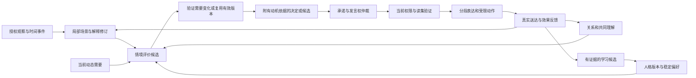

# 专题附录 — 情境行为与人格连续性

场景证据见 [场景矩阵](16-SCENARIO-MATRIX.md)，时序见 [时序推演](18-BEHAVIOR-VALIDATION.md)，验证见 [行为验证](18-BEHAVIOR-VALIDATION.md)。

## 1. 结论等级与设计目标

- **R（现有项目要求）**：愿景、I01–I15、领域与状态契约确定的同一持续身份、开放初始模板、持续定制、分层演化。
- **E（外部研究依据）**：仅在 [情境行为研究](../08-RESEARCH.md) 所列论文的实验范围内成立，不等于 ALIA 已复现。
- **D（架构推导）**：从样例中的可观察效果与反事实推出的工程选择；下文机制、状态和接口语义属于 D，受 R 约束。
- **H（待验证假设）**：模型是否足够幽默、某种注意排序是否自然、演化幅度和冷却时间如何取值；由效果验证实验决定，不能从文学停顿秒数推导统一常量。

目标是让可见行为受经历、情境、人格、约定和实际结果共同约束。M01–M10 描述同一领域架构内的机制，不要求额外微服务或独立人格。没有必要让每次输入调用十个模型。

## 2. 动态关系与时间尺度

该图表达相关事件的依赖，不要求每轮创建所有对象或串行调用模型；下一版本需要只在后续评价读取。直接请求与已有承诺可走原决定路径。安全控制独立于普通推理：

| 时间尺度 | 处理对象 | 边界 |
|---|---|---|
| 控制反射 | 明确停止、撤权、端点失去私密性、控制权被收回 | 立即禁止后续发布/动作，再取消或核验；不等 LLM 同意 |
| 增量交互 | 半句话、ASR 修订、附和、重叠语音、当前片段 | 可推测、可撤销，依赖片段来源；未送达内容不成为既往事实 |
| 场景活动 | 共同看番、联机、工作、后台提醒、闲置活动 | 有期限/预算，允许等待、换话题、暂停与恢复 |
| 当前关切 | 有来源的未解疑问、协调、探索或自主选择诉求 | NeedState 可跨轮持续，与短期 AffectState 分开；事件与有界可信时间更新，不靠离线间隔制造经历 |
| 长期连续性 | 人格、关系、共同符号、习惯、自传和学习 | 有版本、来源、审批边界、删除依赖和回归；不随每句台词重写 |

时钟分离：观察保留采集时间范围与偏差，deadline 按可信时钟执行；恢复后重新计算剩余期限，不把停机间隔叙述为持续经历。语音秒数、文字位置、游戏控制周期各自声明，不能互相冒充。

## 3. 机制责任与最小增量

| ID | 责任与所属模块 | 复用对象 | 状态与因果关系 |
|---|---|---|---|
| M01 | 局部情境，perception/memory | Observation、WorldModel、ContextSource | 活动、共同关注、观察覆盖、忙闲推断和场景接续 |
| M02 | 注意与机会，cognition/agency/runtime | Attention、NeedState、MotivationCandidate、Decision、GoalCommitment、Turn | 需要显著性与可执行性分开；候选保留/合并/过期、发言机会和承诺竞争 |
| M03 | 人格与动机，persona/cognition/learning | PersonaVersion、SelfModel、NeedDefinition、NeedState、Appraisal | 稳定偏好影响评价；评价和需要按版本衔接；定制优先关系与分层演化 |
| M04 | 共享意义与语用，relations/expression | CommonGround、Belief、ExpressionIntent | 共同命名、受众理解证据、玩笑前提及语用修复 |
| M05 | 社交反馈，relations/learning | RelationshipBoundary、Appraisal | 对象/话题局部反馈、范围化可靠性、张力、修复与许可恢复分离 |
| M06 | 兴趣与习惯，agency/persona/cognition/learning | Goal、Task、Preference、NeedState | 有依据的自发候选、活动连续性、习惯形成/衰减与打扰预算 |
| M07 | 感知与信念修订，perception/memory | BeliefVersion、evidence graph | 多个解释、增量撤回、纠错传播与真实性约束 |
| M08 | 表达时序，expression/runtime | ExpressionIntent、DeliveryReceipt、Turn | 分段发布、条件停顿、改口、重叠与送达边界 |
| M09 | 在场与流出，policy/runtime | audience、Binding、EgressPolicy | 输出路径私密性、未知旁听者、跨设备接续 |
| M10 | 控制与行动，agency/capabilities | Action、Task、lease、Outcome | 资源控制权、用户抢占、快控制器与效果核验 |

SceneContext、InteractionOpportunity、InteractionFrame、ExpressionPlan、OutputEndpoint 和 ControlLease 是上述聚合的语义投影或受治理状态，不各自建立另一套身份、事实库或权限系统。SharedSymbol 是 CommonGround 的有来源子对象；Habit 是受约束的偏好和活动模式；PerceptionHypothesis 是既有信念候选，不重新发明一类绝对真理。

## 4. M01 / M07：看见、理解和持续在场

**输入**：授权观察、来源会话修订、有效历史及工具结果。**输出**：场景修订、带证据的活动/实体假设、受影响候选失效集合。场景的写入者是受信任领域命令处理器；感知插件仅提供 DATA。

场景至少表达：参与者、当前共同活动/各自活动、话题、共同关注对象、环境位置或引用、来源覆盖区间、可见范围、活动/忙闲判断的证据与不确定性。活动 proposed 经证据支持进入 active；中断可 suspended，恢复需重新核验后回 active；完成/退出从 active 或 suspended 进入 ended，终态不自动复活。观察覆盖另有 current / stale / unavailable，二者不混同。摄像头断开不证明活动结束，也不允许声称继续看见。

稳定实体 ID 与一次感知结果分开；物体别名、位置、声音标签均可修订。相似头像或声纹候选不能建立认证身份。对于静态图片，“看了三次”“飞了八圈”需要多时点证据；没有就不得形成观察事实。共享画面中出现的文档不自动取得读取其他文档的权限。

感知解释沿既有 unknown/hypothesis/provisionally_accepted/confirmed/disputed/retracted 信念状态运行。部分 ASR 可修订/撤销，最终转写仍可能错误；新特写替换解释时保留更正链。受影响的待发表事实、计划及记忆候选重算；已送达错误需要新的纠正表达，不能改写用户实际听过的历史。高后果动作不得依赖未核实的模糊听写。

**恢复**：读取来源最新会话和覆盖，过期场景保持未知；不以恢复前的画面作当前动作前置条件。**删除**：沿实体关联、场景摘要和解释依赖重建视图，删除后不能从别名或缓存恢复原内容。

## 5. M02：从注意到发言机会

**输入**：M01 场景、人格影响、有效需要与动机、关系、承诺、事件候选。**输出**：silent / wait / defer / reply / act 等既有 Decision，或有明确失效条件的 InteractionOpportunity。

一次机会记录触发事件/对象/话题、动机、相关读集、最早/最晚适用条件、重复键、打扰成本、所需资源与预计占用；不保存预先决定一定要说的台词。候选状态 candidate → eligible → selected → consumed；候选可 blocked / expired / withdrawn，blocked 在条件变化且未过期时重新评估。selected 仅保留执行机会，不证明已经发言；送达/动作事实成立后才 consumed。

仲裁顺序：
1. 先 veto 越权、无效证据、禁止话题、过期环境、不可用能力与预算越界。
2. 明确停止/撤权最高优先；安全处理不参与娱乐性效用竞争。普通直接交互、有截止期限承诺、社交候选和后台工作沿 12 的优先规则仲裁。
3. 在合法集合内比较目标关联、人格倾向、共同意义、新颖性、打扰与占用成本；保留 do_nothing。记录高层选择依据及被抑制原因，不存模型私有推理。
4. 同话题同来源机会可合并，必须保留原证据；有界池满时淘汰未承诺低价值候选。停止、撤权、结果核验与已承诺事项不能因洪流丢失。
5. 发言前复查实际窗口和相关读集。急事出现、明确拒绝或上下文改变后旧包袱撤销；不能只刷新版本号继续发送。

“延迟”由话题仍活跃、对方未说完、当前发言占用或预期接话窗口决定。不得把每次等待硬编码为某个文学秒数。无关事件不使全部机会失效；只有其证据、受众、边界、人格、环境前置条件等依赖变化才重评估。

**恢复**：持久承诺恢复；短命社交机会默认重新判断，过期即丢弃，不补发昨天的笑话。**删除**：撤销依赖内容的机会和生成缓存，保留不含原文的必要诊断。

## 6. M03：同一持续身份的可定制人格与演化

人格包含语义明确的价值偏好、稳定特质、兴趣、习惯和表达偏好。名字是可变展示属性；identity/branch 身份保持。六模板是初始设计例子，可自由组合/修改，不限定维度集合。不同维度可采用不同表示，不把全部人格强制压成统一分数或一句系统提示。

**影响链**：人格 → 注意偏好/评价权重 → 候选动机与有界选择策略 → 表达倾向。例：好奇会增加许可探索的候选；谨慎影响核验需求；玩笑倾向影响候选排序和语用；关系、当前风险和承诺继续限制最终选择。模型只输出建议；策略和 reducer 决定合法状态。不能让“元气”绕过支付，也不能让“赌徒”在用户拒绝后接管鼠标。

人格配置、临时 AffectState、模型提供者风格分开。适应场景的礼貌不自动成为永久人格；主模型降级不算性格成长。用户定制也不能绕开 I01–I15。

### 6.1 变更和优先关系

PersonaChangeProposal 引用基线版本、变更意图、适用范围、作者类别、证据和预期行为差异。状态 proposed → validated → awaiting_consent / eligible_auto → committed；可 rejected / stale / withdrawn。用户明确修改同一字段时，使旧自动候选 stale；不触及该字段的候选仍须重验依赖。临时态不能覆盖持久配置或硬约束。

自由文本定制先生成可审阅语义差异；“更活泼”需要表达清楚将影响哪些行为，而不是隐式扩大权限。认证用户确认后生成新 PersonaVersion。回滚生成新版本并记录来源，只恢复配置；不回滚经历、关系、任务、当前权限、撤销和删除。

### 6.2 默认分层演化

- 兴趣、微习惯、表达允许在明确预授权、证据与回归条件内渐变。
- 名字、显著性格变化、价值偏好变更必须由用户确认。当前默认没有预授权的其他人格字段不自动提交。
- EvolutionPolicy 必须定义允许字段、锁定字段、变更幅度/频率预算、证据独立性要求、漂移判断、回归指标和撤销方式；没有有效政策时只产生建议。
- Evidence 的独立性按共同原始来源折叠；同一次经历的转述/摘要不算多次经历。反馈不足或相互冲突时维持旧配置。
- 数值阈值属于 H01，按效果验证规范的校准实验确定，不将“两条证据/24小时/固定50分”等草拟数字当产品规律。

**恢复与删除**：以已提交版本恢复；模型换供应商重新做人格行为回归。删除引发的派生人格/习惯重算不能被“版本回滚”绕过；所有历史版本按相同删除屏障过滤。用户独立表达且不包含被删敏感材料的偏好可保留，必须有独立来源。

### 6.3 动态需要与动机

**职责**：persona 保存稳定需要偏好；cognition 验证 NeedDefinition、NeedState、Appraisal 与 MotivationCandidate；agency 接管获得许可的持续目标。它们是同一模块化单体内的职责，不是九个模型或新增服务。SelfModel 只引用有效状态投影，不另存可写的需要副本。

| 相近概念 | 保留的唯一职责 | 与需要的连接 |
|---|---|---|
| Persona / Interest / Habit | 稳定价值偏好、兴趣及受控习惯归 persona | 影响关切和候选，不等于当前已有一个未满足需要 |
| NeedState | 此身份当前对某对象/问题的关切、强度及支持 | 引用已有问题/事件，不复制待办、他人心理或外部事实 |
| Belief / WorldModel / CommonGround | 命题、场景、共同未决问题与约定各归原所有者 | Appraisal 读取证据与版本，不能通过评价改写它们 |
| AffectState / Attention | persona 维护短期情境态，cognition 管理注意候选 | 需要可持续而语气已平静；临时态不成为新证据或预算 |
| MotivationCandidate | 期望变化与依据的不可变提议快照 | 附于决定、互动机会或目标提案，不建立第三套候选队列 |
| GoalCommitment / Task | agency 管理承诺、执行、结果与退出 | 可源于需要，也可直接源于用户任务；任务完成与需要缓解分别核验 |

**定义发布与采用**：NeedDefinition 是受信任、版本化的领域规则，定义含义、适用对象、可接受证据、激活/缓解/失效条件、时间作用及上限、强度和支持程度的尺度。模型或插件可提议定义或解释，不能直接发布规则或写入有效需要。新维度可组合已支持的规则语义并补充验证场景，不要求另写一套人格算法。新增规则算子才需领域实现与验证，未知算子拒绝启用；配置不携带任意可执行代码，也不能靠描述注册新 reducer。

定义发布、人格采用与状态重评估是三件事。人格固定引用定义 ID/版本；发布或校准新版本不自动改引用。改变稳定偏好含义的采用仍须用户确认，不能绕过 persona 通过改规则完成。校准配置也固定版本、适用范围和验证记录。旧定义停用后阻止基于它的新激活/选择，依赖状态等待重验或失效；既有事实历史不改写，已承诺任务按自己的执行条件判断。合法迁移记录旧/新定义、人格版本和依据；回滚生成新修订，不恢复旧权限或被删内容。

| 首批说明维度 | 激活依据示例 | 缓解依据示例 | 可以影响的位置 |
|---|---|---|---|
| 自主选择 | 当前活动中存在未经解释的限制或选择冲突 | 取得解释、可接受的选择空间或有依据地修订判断 | 关注控制来源、生成询问/协商/接受候选；有效停止始终先执行 |
| 理解 | 已识别且与当前问题有关的信息缺口 | 可靠回答、查证结果或证实问题前提不成立 | 提出解释假设、选择是否进一步核验 |
| 关系协调 | 有来源的误解、未对齐约定或协作需求 | 澄清、实际协作结果或双方明确调整约定 | 关注他人处境、提出修复或协调候选；不臆测他人内心 |
| 探索 | 已授权场景中的兴趣线索或仍有效的开放问题 | 实际探索反馈、目标完成或有依据地重新评价兴趣 | 生成合法的新颖行动候选，比较收益与打扰成本 |

这些维度保持开放，不是固定人格分类。“好奇”数值只能在定义明确的作用位置使用，不能指定一句回答或一个动作。人格可影响注意、解释假设、核验倾向、候选生成、合法集合内的权衡和表达；事实来源、证据状态与安全下限不随人格改变。

**归属、粒度与状态**：NeedState 属于 tenant/identity/branch/access_scope；对象引用只描述关切涉及谁或什么，不改变需要归属或授予行动权。它包含定义/人格/评价与原始来源版本、场景/问题引用、关联目标、强度、支持程度/不确定性、有效窗口、转换依据及 data_policy。fiction_scope 与现实作用域分开。按授权域、定义语义标识、对象/问题、活动连续性和虚构范围确定同一关切；同义改写、换对话、重复事件或换定义版本不能直接创建第二份激活。无法安全合并则保持独立候选待核验，不能跨受众/主体合并泄露。

强度表示当前关注程度，支持程度表示激活/解释依据是否可靠，均不表示权限。激活候选经领域验证与应用提交成为 active；有缓解/解决证据可减弱或进入 settled；期限到达为 expired；必要依据、规则或作用域不再成立为 invalidated；有合法明确的放弃该关切/退出该活动决定时可 withdrawn。只拒绝一次动作、预算不足或取消一个任务，不自动撤销需要。多来源中部分撤回先重算；仍有独立有效支持可保留经重验的 active。终态不原地复活，新依据或明确重新开启才可建立有前驱的新实例；原拒绝仍单独生效。放弃、过期、容量未接纳和来源失效都不冒充已解决。删除按屏障清理。

**一次更新的因果边界**：评价读取 `N_t`（可为空）及当时有效的人格、信念、关系、承诺，提出下一版本。应用先验证并提交评价、需要变化及相关候选失效，再生成行为候选；若同事务预计算选择，则须验证所提交版本的一致性。模型调用在事务外。无状态变化时不递增需要版本；本次评价保存确切输入/输出版本，不因自己的合法提交自我失效。

来源贡献、运行读集和普通关联分别保存：贡献沿原始来源及修订去重；read_set 核验本次读取；关联目标/问题只便于归因，不算新证据。派生因果边指向确切历史修订，不能用对象 ID 的互相引用构成自证环。`N_t+1` 可在后续评价作上下文，但需要更新事件、自己的自述和摘要不会因换了事件 ID 就成为独立支持。来源修订替换旧贡献；撤回、删除或规则变化按仍有效来源重算，不在旧总分上再次叠加。反思只提候选，不能以自己的上一轮判断确认下一轮判断。

**动机与执行分离**：MotivationCandidate 记录期望改变什么、需要/评价/证据版本、对象/场景、有效窗口、成本估计与退出依据。它是依据快照，不拥有独立执行状态或预算。即时选择可直接使用；需等待的短期候选交给 InteractionOpportunity，持续工作交给 GoalCommitment，生命周期由接收方管理。交接以目的及来源关联去重，接收记录与目标引用同事务；不能在两个队列分别执行同一意图。一个需要可有多个候选，一个候选可权衡多个需要；同一事件可支持不同关切，但仍只算一个原始证据。不同定义的强度不能未经校准直接求和，引用数量也不是额外收益。

即使需要 active，也可等待、沉默、暂缓或不行动。相同对象/问题/目的的拒绝抑制跨重试、改措辞、实例重建和定义升级保持；只有适用边界合法改变才重评估。需要结束不自动取消独立承诺。已承诺任务保留当时动机为历史依据，后续按明确执行前置条件、权限、期限和退出规则继续；不会随需要每次时间变化被迫取消。若持续需要本就是任务的必要前提，须在承诺时明确，失效后由 agency 暂停/退出；删除与撤权始终先行。

**事件与有界时间共同驱动**：合法观察/反馈、相关配置或来源修订，以及可信时间可触发检查。空需要集不妨碍根据已确认偏好与当前授权场景提出探索候选，也不要求普通任务先制造一个需要。runtime 提供可信时间和已有调度资源，cognition 执行定义规则。每种定义固定显著性的时间作用、总边界/最大变化、最小间隔、场景及过期条件；重复/重叠区间不能重复贡献，时钟回退不产生额外增长。时间不增加事实支持程度、生成经历或证明满足。无经验证的时间配置时只做期限和有效性检查；状态尺度未定义时不得自行分配数值或比较分数。

增长/衰减、尺度和触发参数由 H07 校准；容量和检查频率与 H02 的负载/打扰实验共同确定，不从文学次数或本示例推导产品常量。

检查沿用有界机会池与后台任务预算；活跃需要数、来源边数量、单次检查/候选数、保留和模型调用分别受既有资源政策限制。容量不足时合并确属同一关切的候选，或拒绝接纳/有界延后，并记录覆盖不足；不能悄悄当作“没有需要”，也不能因池满丢弃停止信号或已承诺任务。轻量检查先行，合法事件或有价值的候选按推理预算准入；生成候选的模型调用不要求先有一个已生成的 eligible 行为。不逐 tick 调模型，无语义变化的检查不使全部依赖陈旧。读取、提交和释放时仍核验有效期及必要依赖，不依赖后台到期任务准时运行。未能重验时不使用陈旧状态，不把它标为满足。

离线恢复先核对定义、人格、来源、场景、授权、删除屏障及期限，再建立新的调度基点，不补算停机显著性变化或追发错过的请求。仍可依有效来源重建当前关切。撤销动作授权不必抹去可合法保留的关切；撤销数据用途/访问范围则阻止相关使用。恢复与重算不是追加新经历。

**反馈和学习**：反馈须关联原决定/机会/目标及实际送达、动作、结果，再检查定义中的缓解依据。发送问题不等于取得答案，执行查询不等于结果可靠，任务完成不等于其关联需要全部满足。部分或含混反馈只支持相应范围的变化。自述与自身派生解释不成为独立证据；人物可靠性也不能由“因为信他而采纳的话”循环确认。信念、范围化关系、程序性记忆/Habit、稳定人格各走自己的证据及提交规则，不要求每次反馈都改动所有层级。详细归属见[运行算法](../02-RUNTIME-ALGORITHMS.md)。

## 7. M04：共同符号、语用与事实

**输入**：可见交互、实际送达、对方回应和局部信念。**输出**：CommonGround 修订、SharedSymbol、InteractionFrame 与表达候选。

共同命名状态 proposed → presented → grounded；presented 需要送达证据，grounded 需要与对象/命名有关的明确采纳或后续一致使用。单纯发送、无关笑声或模型推测不证明理解。被纠正则 disputed，澄清后产生新版本；撤回/删除后不可再以原共同意义引用。公共场景中新加入的人不自动继承私聊共同知识。

SharedSymbol 引用对象、命名经历、双方已知程度、适用受众/场景、最近使用及禁用/冷却依据。检索只得到可用材料；M02 再决定是否值得提起。可引用“曾这样命名”的真实事件，不能推出“鸭子真实审批电费”。

InteractionFrame 表示 factual / joke / metaphor / quote / roleplay 等语用及其范围、参与者、前提、来源、有效期和修复入口。框架 proposed → active → repairing / closed；话题切换不明确时不能让虚构前提污染新任务。一个表达可含不同语用片段，事实部分单独具证据。事实错误即使在玩笑旁边也要更正；对真实能力/身份的直接询问按事实作答。

模型负责语言创造和语用识别建议，核心限制事实提升、受众和副作用。无需在普通消息显示内部标签。“嘴硬”的表达可以保留，但已知胶带不能继续作为水杯事实，真实工具失败不能用玩笑改成成功。

**删除**：命名原文、别名、使用记录、摘要与派生笑话候选一并纳入 lineage；可表达“目前没有可用依据”，不能伪称从未发生或泄漏删除请求内容。**恢复**：只恢复仍授权的共同理解，不能用角色卡补全过去。

## 8. M05：关系张力、反馈与修复

Relationship 维护 actor/topic/scene 范围的互动偏好与边界，Appraisal 保存本次影响判断。张力和信任是带来源的多维解释，不是统一好感分，也不是行动授权。

人物可靠性另带领域、情境、证据来源和有效时间；原始说法与验证结果归 memory，relations 保存引用这些证据的范围化判断。共同原始来源只计一次，全新领域保持未知。关系亲近、“长辈”等称呼不产生控制权；合法控制者的有效停止命令先停止受控活动，后续允许的询问或表达才进入人格权衡。

反馈分 explicit_stop、explicit_permission、correction、engagement、ambiguous、unknown。笑声可能与别的话有关；沉默可能是忙碌、延迟或未听见。含混反馈只能调低主动程度或适时澄清，不能直接认定对方愤怒。明确停止立刻约束相关行为；停止范围按本人指示，不能擅自扩大成跨场景永久绝交。

修复进程 suspected_mismatch → acknowledged → adjustment_applied → monitoring → repaired / unresolved。道歉只到 acknowledged；后续未见场景中行为改善才支持 repaired。修复和玩笑许可分开：道歉被接受不代表被禁止的具体话题重新开放。恢复边界需对方明确、可认证的许可；日常非禁止话题的风格适应仍可按证据渐变。

冷战表现可为减少非必要主动交流，但不得以惩罚方式扣留已承诺工作或安全提醒，不制造情感负债。退出关系模式、停止或免打扰应直接生效。

**删除**：清除原话及敏感推断；删除原拒绝文本不默默解除独立的当前撤权/停止。只保留当前请求范围允许的最少边界状态；若该边界本身也明确请求删除/撤回，通过认证命令处理，后续采用保守默认，不反推被删主题。**恢复**：有效边界先于任何表达恢复，未决修复不得被新模型自动当作已解决。

## 9. M06：自发活动和微习惯

“无目的”表示没有用户任务，不表示运行时没有选择原因。兴趣、可用能力、新颖性、共同项目和资源余量可产生 candidate；不能以无限“无聊值”保证必然打扰。

活动复用 GoalCommitment/Task：承诺沿 candidate→approved→active→paused/completed/cancelled/failed；其执行任务沿 05 的 queued/leased/running 等状态，效果不确定时任务进入 needs_reconciliation，不能把承诺直接记为完成。必须区分提议活动、实际运行和产生结果；只有结果支持“刚才下了几局棋”。用户不在场、服务关闭或能力不可用时不得虚构经历。

习惯模式 observed_pattern → proposed → active → suspended/retired，记录触发条件、证据、偏好收益、资源/打扰代价和退出条件。一次行动不建立习惯；强化/衰减依赖重复且独立的有效结果及用户边界。长期无证据不会凭时间自动积累经验。用户移除习惯优先于重复触发。

已承诺紧急事项、免打扰和预算不足压过娱乐候选；停止后取消继续调度。恢复时核对能力、授权、目标和预算，不能把错过的定时点全部补发。证据删除影响对应习惯/偏好，不影响有独立依据的承诺。

## 10. M08：增量表达、改口与真实送达

**输入**：已验证决定、语用框架、实际发言权、媒介能力及新输入修订。**输出**：分段 ExpressionIntent 投影、取消信号和 DeliveryReceipt。

ExpressionPlan 是既有表达意图的时序设计，包含片段依赖、语用、内容引用、可发布条件/截止、停顿条件、可打断点、相关动作前后置关系及端点依赖。Expression 1.0 使用 typed 契约表达计划负载，执行前验证明确的负载语义；当前尚未实现端到端时序执行。

计划的内部进度为 planned → released → started，再按实际结果记完成范围、部分进度、中断、失败或抑制。released 表示交给适配器，不能作为已送达回执。投影到现有 DeliveryReceipt 时，整体使用 planned/started/partial/completed/interrupted/failed/suppressed；其 segments 只使用既有 delivered/interrupted/failed 与实际位置，各状态保持职责一致。未发布内容可修订；已发布未播内容需要取消确认；已送达内容不可撤回成“从未说过”。下一片段必须重新验证仍有意义且授权有效。

新输入是附和、抢话、停止、修正还是无关噪声，由有来源的检测候选和策略决定；明确停止由控制反射兜底。播放回声不能当成另一个人发言。误暂停只在语义、授权和有效期仍成立时恢复，不能重播已送达部分。

表达速度是媒介能力，不以缩短事实校验换取抢拍。原生全双工提供者也不得直通未经许可的工具或敏感语音；缺少可控发布/取消边界的提供者不用于该敏感路径。真实韵律、唱歌、笑声和形象动作均须单独适配能力证明。

**删除与恢复**：待播缓冲、生成缓存、计划、字幕、送达内容引用都属于派生链；删除/撤权先阻止续播。恢复从已记录的每媒介位置接续，无法确认的位置标记不确定，不假装已听见。

## 11. M09 / M10：跨端连续性与共享控制

在场分三个维度：认证用户/会话、当前活动、实际输出路径。OutputEndpoint 表示通道、可达性、私密/共享/未知、受众及路径修订。群成员未变不意味着旁听范围未变；耳机变外放、投屏开启或窗口被共享都需要新流出判断。未知旁听者不虚构身份，按暴露风险处理。

私密输出遇到路径变共享/未知/不可达：先阻止后续发送并请求停止在途播放，记录已知暴露范围，再请求用户选择安全路径。不能保证收回已经外放的声音，也不能只靠云端晚到通知消除泄漏；敏感媒体适配契约须支持本地先暂停/禁止自动切外放。跨端恢复依赖同一个 identity/branch 和授权活动引用，不复制人格或跨范围搬运上下文。

ControlLease 仅是已授权资源使用权，不是访问许可。绑定 resource、持有人、用途、generation、期限和允许动作；状态 available → held → releasing/revoked/expired → available。用户接管、撤权或安全条件失效使旧代次失效；新控制权不得复用旧句柄。租约竞争有界等待，不能为搞笑抢回用户明确收回的鼠标。

高层选择游戏目标/技能，特定控制器执行快速观测—动作闭环；控制器受租约、前置条件、预算和急停约束。说话、图像生成、群发送、修改壁纸、付款各自授权和确认，不能因一个“整活意图”合并成成功。文件删除/支付等副作用不因表演失败而降低风险级别。

**恢复**：终端重连重新认证并取得新绑定；旧租约不可复活；未确定动作先核验。**删除**：清除任务/表达中敏感输入及派生物，已经合法外发但不可收回的内容如实说明边界。

## 12. 概念接口、读集与持久化责任

以下是设计语义，不是新代码、HTTP 路由或已发布 wire schema。

| 接口责任 | 输入 → 输出 | 拒绝/失效条件 |
|---|---|---|
| Scene 更新/修订 | 授权 Observation + 来源修订 → 局部场景及依赖变化 | 来源失效、观察超范围、无证据身份合并 |
| Attention 提议/仲裁 | 场景+人格+关系+承诺 → 候选/决定 | 越权、过期、重复、受众不匹配、预算不足 |
| Persona 读取/预览/确认/回滚 | 认证主体+基线版本+语义差异 → 候选或新版本 | 未授权、基线过期、字段越界、删除依赖 |
| EvolutionPolicy 读取/修改 | 认证配置命令 → 有版本的规则 | 不完整规则、突破硬约束或绕过必要确认 |
| Need 评价/更新/时间检查 | 授权事件+可信时间+定义/人格/当前需要及证据版本 → 评价、下一需要版本与失效集合 | 证据重复/撤回、范围失效、读集冲突、无效时间配置或删除屏障 |
| Motivation 提议/交接 | 有效需要/评价+期望变化+范围/成本/期限 → 决定依据或互动机会/目标提案 | 读集失效、重复交接或超范围；拒绝/等待由接收方管理，交接不授执行许可 |
| CommonGround 建立/修复 | 送达+理解证据 → 局部共同意义 | 无理解证据、受众变化、错误实体关联 |
| Expression 计划/发布/取消 | 已授权决定+片段+端点版本 → 投影/回执 | 发言权、语义、端点、来源、授权或期限失效 |
| Control 申请/接管/释放 | 已授权动作+资源状态 → 租约及核验要求 | 冲突、旧代次、用户接管、前置条件丢失 |

候选读集只引用相关资源修订：事件/感知解释、活动/话题、人格字段或版本、关系边界、共同意义、环境动作前置条件、端点/受众、授权/撤销及删除屏障。版本冲突先重新判断依赖语义；不能无条件重试旧决定。已送达事件属于历史，迟到回执仍用于核验，但不追授旧授权。

读集的提交与修订单位遵循[状态契约](../05-STATE-CONTRACTS.md)。

持久化分层：人格/关系/共同符号/习惯/承诺是长期受控状态；机会/活动/端点/控制租约有期限且必须支持崩溃后的失效判断；音视频热流按现有数据面政策，不把每帧持久化为人生经历。输入事实、派生解释和审计引用分开，继续使用 owner/purpose/classification/retention/lineage。数据归属、约束和迁移原则详见 [数据存储](13-DATA-STORAGE.md)。

## 13. 能保证与不能保证的效果

在未来正确实现并验证后，架构可以强制权限、来源、状态转换、取消、送达和删除边界；可使人格/记忆对行为的影响可追踪。它不能独自保证笑话好笑、语用识别总正确、音画可辨、所有游戏可控或每次都出现文学级对白。相应 H 假设必须通过模型/媒体能力试验与盲评验证，不将模拟效果或设计一致性当成产品验收。

## 14. 行为约束组合、竞争与退出条件

日常调侃、认真协作、关系修复和紧急响应是 Decision 的**情境约束组合**，不是四个人格，也不要求四个模型。cognition 根据场景/评价/边界/承诺提议当前约束，提交记录进入依据、有效范围、退出条件与版本，expression 依其规划。

| 约束组合 | 进入依据 | 对候选的影响 | 退出/重评估 |
|---|---|---|---|
| 日常交流 | 无紧急条件，关系/活动允许，存在合适互动机会 | 可比较玩笑、兴趣、问候与沉默，受打扰成本限制 | 对方忙碌、明确请求认真、主题不适或高优先级事项出现 |
| 认真协作 | 明确任务、期限或用户要求；正在核对事实/结果 | 优先有用信息、可靠工具和承诺；非必要包袱延后 | 任务完成/暂停且当前窗口适合，不能因一句笑声忽略未完承诺 |
| 局部修复 | 有明确拒绝/错误归因，或有来源的疑似不适 | 收紧对应对象/主题，允许承认和正常协助，不施加惩罚性沉默 | 误解澄清或后续行为验证；解除禁止仍需另有依据 |
| 紧急响应 | 可信安全/停止/撤权信号，或已核验紧急承诺 | 硬门禁与控制反射先行，取消不适用社交候选；最低必要表达 | 风险条件被可靠新证据解除/交接；没有后续消息不等于危险消失 |

多个约束可共存：修复某话题不妨碍认真帮助另一任务；任务中的轻松表达不能打开已禁主题。冲突时先执行停止/权限/删除/安全硬约束，再按[算法中的承诺仲裁](../02-RUNTIME-ALGORITHMS.md)和[媒介发言权规则](../03-MEDIA-EXPRESSION.md)处理。临近截止的承诺应重新评价紧迫性，不能被源源不断的娱乐输入饿死。

为防止反复切换，含混新信号先保留候选解释，不立即覆盖已证实的约束；退出需满足明确的证据条件。进入/退出阈值、最短保持时间若使用，属于 H02/H05 校准项，不能擅定“24 小时”或固定冷场时间。新证据、拒绝、用户接管随时可触发强制重验，不受任何风格保持时长阻挡。

逻辑所有者由 [01](../01-ONTOLOGY-ARCHITECTURE.md) 固定，数据关联/事务由 [数据存储](13-DATA-STORAGE.md) 约束；每次跨模块提交使用原事件因果链与 read_set，不让双方各自持有一个可冲突的“当前人格/当前关系”权威副本。
